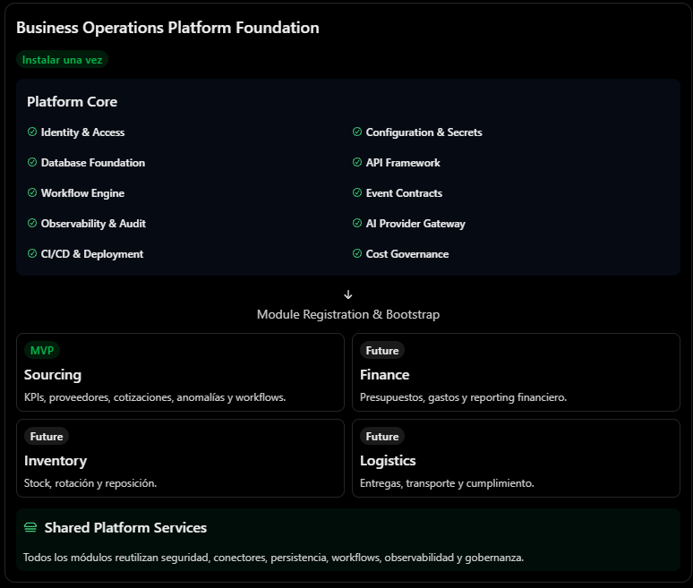
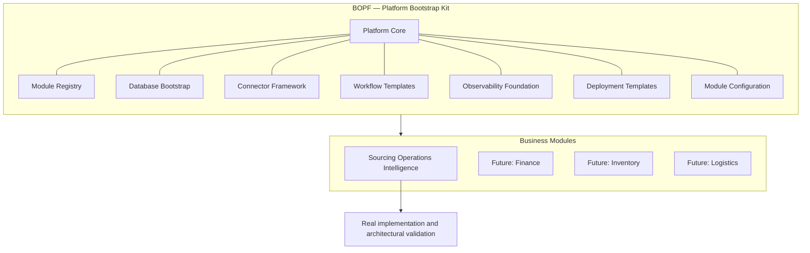
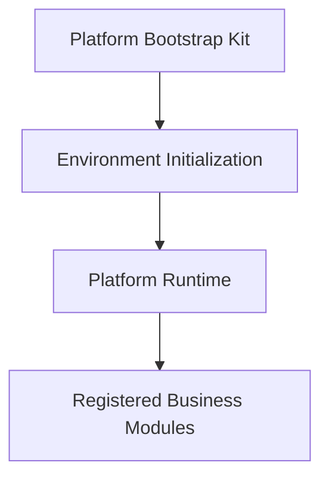

# Business Operations Platform Foundation (BOPF)

**A reusable enterprise Platform Bootstrap Kit for building, integrating, and operating business intelligence and automation modules.**

BOPF establishes the shared architectural and operational foundation required to initialize an enterprise environment and incorporate new business modules through a standardized registration and integration process.

The platform will be validated through a real, fully functional business module: **Sourcing Operations Intelligence**.

---

## Overview

Enterprise automation initiatives often require rebuilding the same foundational capabilities: authentication, persistence, integrations, job execution, monitoring, auditing, and deployment infrastructure.

BOPF addresses this problem by separating reusable platform capabilities from domain-specific business functionality.

Rather than developing a collection of disconnected applications or shared libraries, BOPF provides a **Platform Bootstrap Kit**: a structured, extensible foundation that allows business modules to operate within a consistent enterprise environment.

Its central architectural principle is:

> **Build the platform once. Incorporate business capabilities as independent modules. Validate extensibility through real implementations.**

## Architecture at a Glance

BOPF distinguishes between two architectural concerns:

- **Platform Foundation:** reusable infrastructure, integration contracts, and operational mechanisms shared across modules.
- **Business Modules:** domain-specific functionality implemented using the platform's capabilities.



*Platform Foundation capabilities are installed once; the Sourcing MVP and future business modules register on top and reuse shared services.*



The Bootstrap Kit provides the mechanisms required to register, configure, initialize, and operate modules. Each module supplies its own business logic and domain-specific components.

## The Bootstrap Kit, Platform Runtime, and Business Modules

A fundamental architectural distinction in BOPF is that the **Bootstrap Kit and the running platform are related, but they are not the same thing**.

| Architectural element | Definition |
|---|---|
| **Platform Bootstrap Kit** | The reusable structure, templates, contracts, and mechanisms used to initialize an enterprise environment. |
| **Platform Runtime** | The actual operational environment instantiated from the Bootstrap Kit, providing shared services and infrastructure to registered modules. |
| **Business Modules** | Independently developed domain capabilities registered into the Platform Runtime through standardized integration contracts. |

Conceptually, the relationship is:



This distinction defines the intended architecture: BOPF is not merely a shared-code package. It is a reusable foundation for initializing and operating an extensible enterprise platform.

## What the Bootstrap Kit Provides

| Foundation | Responsibility |
|---|---|
| **Platform Core** | Shared components, application contracts, common services, error handling, and platform lifecycle mechanisms. |
| **Module Registry** | Explicit registration of available modules, versions, dependencies, compatibility requirements, and permissions. |
| **Database Bootstrap** | Database initialization, schema provisioning, migration management, and platform configuration data. |
| **Connector Framework** | Standardized interfaces and reusable mechanisms for integrating external data sources and enterprise systems. |
| **Workflow Templates** | Reusable workflow patterns for execution, notifications, retries, exception handling, and human approvals. |
| **Observability Foundation** | Centralized logging, metrics, traceability, execution monitoring, and audit capabilities. |
| **Deployment Templates** | Reproducible development environments and deployment configurations for enterprise infrastructure, initially targeting Docker and AWS. |
| **Module Configuration** | Standardized configuration and capability declarations for individual business modules. |

These capabilities establish a common operating environment without requiring each module to independently reconstruct its infrastructure.

## Modular Architecture

Business modules are domain-oriented components that extend the platform through standardized contracts.

Each module owns its business-specific implementation, which may include:

- Domain entities and business rules.
- Data connectors and ingestion logic.
- Domain-specific APIs and services.
- KPIs, analytical models, and reporting capabilities.
- Machine learning models and AI integrations, where justified.
- Workflows, notifications, and approval processes.
- Module-specific configuration, permissions, and database migrations.

The platform provides the shared mechanisms; modules provide the business capabilities.

### Example: Incorporating a Finance Module

A future Finance module should be able to use the existing platform foundation rather than independently rebuilding:

- Authentication and authorization.
- Database connectivity and persistence mechanisms.
- Module registration and lifecycle management.
- Job execution and error handling.
- Connector integration contracts.
- Workflow orchestration mechanisms.
- Logging, monitoring, and auditing.
- Deployment and configuration infrastructure.

The Finance module would contribute its own financial entities, connectors, calculations, KPIs, models, and workflows.

This does not mean that adding a module requires no engineering. Each module must implement its domain functionality and satisfy the platform's integration contracts. The objective is to eliminate duplicated foundational engineering, not domain-specific development.

## Architectural Validation: Sourcing Operations Intelligence

BOPF will not be developed as an abstract framework disconnected from real business requirements.

Its architecture will be validated through **Sourcing Operations Intelligence**, the first fully functional business module.

This module addresses sourcing and procurement operations by consolidating operational data, monitoring supplier performance, identifying exceptions, generating business intelligence, and supporting workflow automation.

Its initial business scope covers:

- Data integration and processing.
- Supplier and sourcing operational analytics.
- KPI calculation and performance dashboards.
- Predictive analytics and anomaly detection where justified.
- AI-assisted supplier communication classification and information extraction.
- Automated reporting, notifications, and exception workflows.
- Human validation and approval of consequential decisions.

Sourcing is both a business solution and an architectural validation environment.

It must demonstrate that the platform can support a complete operational module while preserving separation between shared infrastructure and domain-specific functionality.

## Development Philosophy

### Build mechanisms, not hypothetical modules

BOPF will implement the capabilities required to incorporate future modules, but it will not develop hypothetical business functionality in advance.

| Build now | Build when needed |
|---|---|
| Module registration mechanisms | Finance business logic |
| Standardized module contracts | Inventory management functionality |
| Database and migration infrastructure | Logistics-specific workflows |
| Reusable connector interfaces | Domain-specific integrations |
| Workflow execution patterns | Future business processes |
| Shared observability and auditing | Module-specific monitoring requirements |
| Deployment foundations | Infrastructure expansions justified by actual demand |

This approach prioritizes working functionality, architectural validation, and evidence-driven extensibility over speculative abstraction.

### Core principles

1. **Platform-first architecture:** establish reusable foundations before expanding business capabilities.
2. **Domain ownership:** each module owns its entities, rules, and business processes.
3. **Explicit extensibility:** modules integrate through defined contracts and controlled registration.
4. **Reuse without overengineering:** implement shared capabilities when they have a clear architectural purpose.
5. **Operational reliability:** prioritize security, traceability, recoverability, and controlled execution.
6. **Incremental validation:** use Sourcing to prove that the architecture works in practice.
7. **Evidence-driven expansion:** introduce new infrastructure and capabilities only when justified by concrete requirements.

## Intended Technology Foundation

The initial architecture is based on the following technologies:

| Area | Technology |
|---|---|
| Application backend | Python, FastAPI |
| Database | PostgreSQL |
| Database migrations | Alembic |
| Dependency management | uv |
| Asynchronous execution | Independent Python workers |
| Workflow orchestration | n8n |
| Business intelligence | Power BI |
| Machine learning | Python, Scikit-learn |
| AI integration | Provider-independent LLM integration |
| Local environment | Docker Compose |
| Production infrastructure | AWS (ECS Fargate, RDS, S3, and supporting services) |
| CI/CD | GitHub Actions |

The technology choices establish an initial implementation baseline. Individual components may evolve through explicit architectural decisions as the platform develops.

## Expected Outcome

BOPF aims to deliver two complementary outcomes:

**1. A reusable enterprise platform**

A reproducible foundation for initializing environments, registering modules, integrating external systems, executing business workflows, and operating applications with consistent security and observability.

**2. A fully functional business solution**

Sourcing Operations Intelligence, demonstrating that the platform supports real data integration, business analytics, predictive capabilities, AI-assisted processes, and workflow automation.

The success of BOPF will not be measured by the number of abstractions or hypothetical modules it supports. It will be measured by the reliability of its foundation and its demonstrated ability to incorporate and operate independent business capabilities without duplicating platform infrastructure.

## Development Setup

### Prerequisites

- Python `>=3.11` (Python 3.11 recommended)
- [`uv`](https://docs.astral.sh/uv/) package manager (`>=0.8`)

### Environment Initialization

```bash
# 1. Create local environment file from example template
# Windows CMD:
copy .env.example .env
# PowerShell / Bash:
cp .env.example .env

# 2. Synchronize dependencies from the committed lockfile
uv sync --locked --extra dev

# 3. Verify lockfile consistency
uv lock --check
```

### Configuration & Secret Hygiene

Application configuration is centralized in `src/app/core/config/` using Pydantic Settings.

- **Zero committed secrets (INV-016):** `.env` is ignored by `.gitignore` and `.dockerignore`. Never commit real tokens or credentials.
- **Local synthetic defaults:** Safe defaults are provided for local development (`DB_HOST=localhost`, `DB_PORT=5432`, `DB_USER=postgres`, `DB_PASSWORD=postgres`, `DB_NAME=operations`).
- **Database host selection:**
  - When running migrations, tests, or application processes **on the host machine**, use `DB_HOST=localhost`.
  - Inside the **Docker Compose bridge network**, use `DB_HOST=db`.
- **Production safeguards:** In `production` environment (`ENVIRONMENT=production`), debug mode is blocked and default/trivial passwords raise immediate startup errors.

### Quality Tooling Commands

```bash
# Code formatting check
uv run ruff format --check .

# Code formatting apply
uv run ruff format .

# Linting check
uv run ruff check .

# Static type checking
uv run mypy src tests

# Automated test execution with coverage
uv run pytest
```

---

**BOPF — A reusable foundation for enterprise business intelligence and automation.**