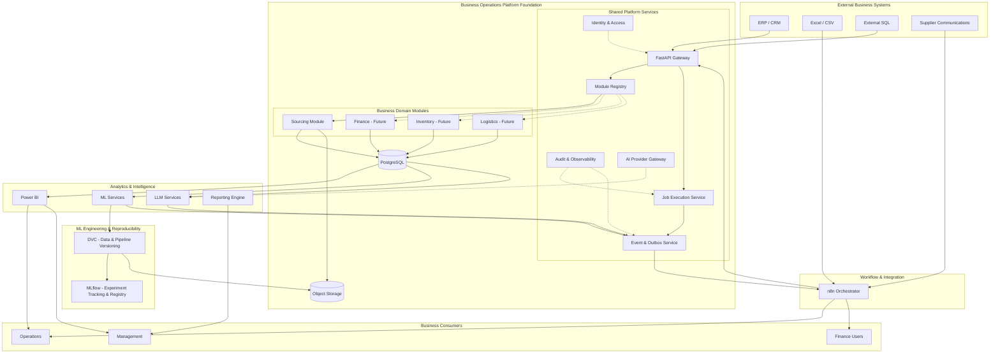
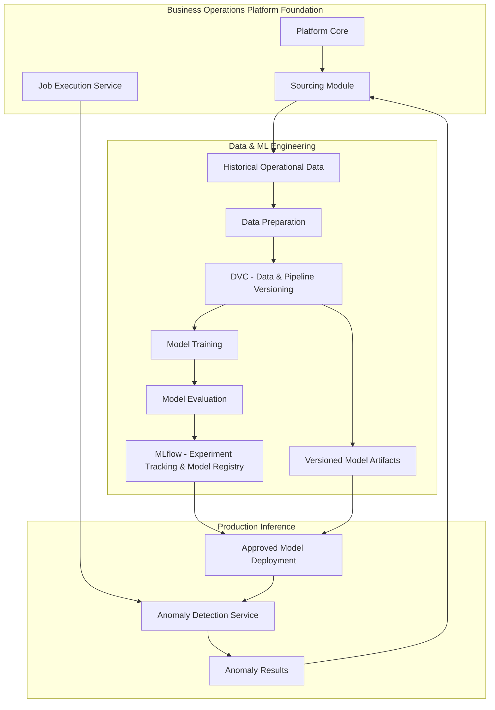
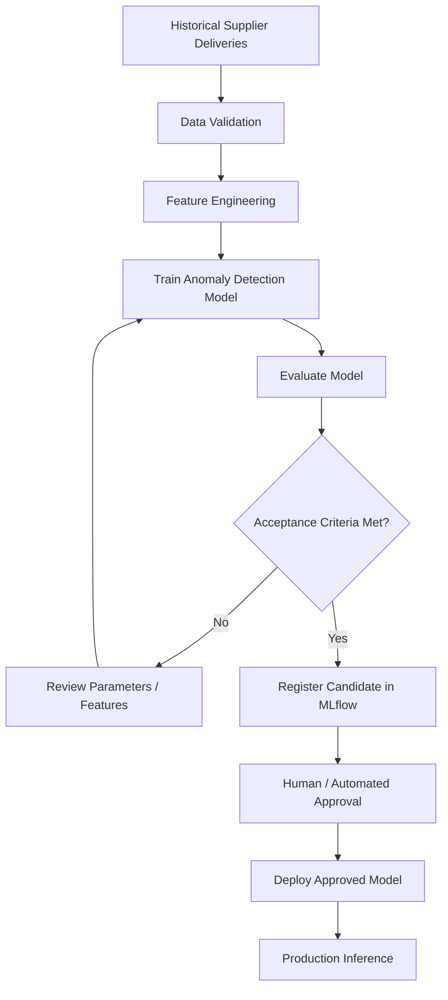

# Architecture & Engineering Blueprint

## AI-Powered Business Operations & Reporting Platform

Architecture baseline

MVP: Sourcing Operations

Version 1.0

Document purpose: Define the software architecture, engineering standards, component boundaries, integration contracts, deployment model, and implementation strategy for the platform.

This blueprint translates the Product Charter into an engineering specification that can guide implementation and serve as the architectural reference for future development.

## 1. Architecture decisions before implementation

There is one distinction that will influence almost every technical decision:

We are building a modular enterprise platform, not a collection of independent applications and not a generic microservices framework.

The architecture needs to satisfy two requirements simultaneously:

1. Deliver a complete, operationally useful Sourcing module within a reasonable MVP scope.
2. Establish a reusable technical foundation that supports future business modules without duplicating infrastructure or rewriting existing functionality.

I recommend the following architectural baseline.

| Decision                 | Selected approach                                                 |
| ------------------------ | ----------------------------------------------------------------- |
| Application architecture | Modular monolith                                                  |
| Business organization    | Domain-oriented modules                                           |
| Backend                  | FastAPI                                                           |
| Execution model          | API + independent worker                                          |
| Database                 | PostgreSQL                                                        |
| Workflow orchestration   | n8n                                                               |
| Business Intelligence    | Power BI                                                          |
| ML execution             | Python / Scikit-learn                                             |
| Data & pipeline versioning | DVC (Git-tracked datasets, pipelines, parameters and artifacts)  |
| Experiment tracking & registry | MLflow (experiments, metrics, model lifecycle)              |
| Generative AI            | Provider-independent LLM integration                              |
| Infrastructure           | Docker initially, AWS ECS Fargate for production                  |
| Deployment automation    | GitHub Actions                                                    |
| Module registration      | Explicit, allowlisted module registry                             |
| Inter-module integration | Versioned contracts and domain events                             |
| Initial tenancy model    | Single enterprise deployment                                      |
| Future scalability       | Independently scalable workers and selectively extracted services |

### Architectural principle

We will implement reusable abstractions only when they have a defined responsibility and an identifiable consumer.

For example, a common connector interface is justified because multiple modules will consume external data. A generic autonomous agent framework is not justified because the MVP does not require autonomous agents.

The platform must be extensible without becoming overengineered.

## 2. System architecture

The platform will have five architectural levels:

- Platform Foundation: common infrastructure and capabilities.
- Business Modules: domain-specific business functionality.
- Integration Layer: external systems, workflow orchestration, and event exchange.
- ML Engineering & Reproducibility: version-controlled datasets, reproducible pipelines, experiment tracking, and model lifecycle.
- Presentation & Delivery: dashboards, reports, notifications, and approval interfaces.

### 2.1 High-level architecture



The dotted connections represent shared platform services rather than synchronous execution dependencies.

### 2.2 Component ownership

A critical design decision is establishing which component owns each responsibility.

| Component       | Owns                                            | Does not own                          |
| --------------- | ----------------------------------------------- | ------------------------------------- |
| FastAPI         | Application APIs and request validation         | Long-running workflow execution       |
| Platform Core   | Shared infrastructure and contracts             | Business-specific policies            |
| Sourcing Module | Sourcing entities and business rules            | Generic platform infrastructure       |
| PostgreSQL      | Authoritative structured application data       | Workflow orchestration                |
| n8n             | Workflow coordination and external integrations | Core business calculations            |
| Python workers  | Data processing and analytical jobs             | User-facing orchestration             |
| Power BI        | Business visualization                          | Source-of-truth business calculations |
| ML services     | Predictive and anomaly signals                  | Final business decisions              |
| DVC             | Dataset, pipeline and artifact versioning       | Business data storage, orchestration  |
| MLflow          | Experiment comparison and model lifecycle        | Dataset versioning, production serving |
| LLM services    | Classification, extraction, explanations        | Authoritative numerical calculations  |
| Policy engine   | Deterministic decisions and permissions         | Probabilistic interpretation          |

This separation prevents different technologies from taking responsibility for the same business logic.

For example, n8n can trigger a supplier-performance analysis, but the actual calculation belongs to the Sourcing Module. The LLM can summarize its findings, but it cannot override the calculated indicators.

## 3. Business Operations Platform Foundation (BOPF)

BOPF is the most important architectural element.

It represents the reusable foundation that future business domains will share.

I would divide it into ten capabilities.

### 3.1 Platform Core

The central application infrastructure.

Responsibilities:

- Application configuration.
- Environment management.
- Module discovery and registration.
- Dependency validation.
- Common error handling.
- Shared utilities.
- API registration.
- Platform health checks.

The core must not contain supplier-specific logic, financial calculations, inventory rules, or other domain-specific behavior.

### 3.2 Identity & Access Management

Provides centralized authentication and authorization.

Recommended approach:

- OpenID Connect for user authentication.
- OAuth2/JWT validation for protected APIs.
- Role-based access control (RBAC).
- Service-to-service authentication.
- Least-privilege permissions.

Initial roles:

| Role                   | Access                                       |
| ---------------------- | -------------------------------------------- |
| Platform Administrator | Platform configuration and module management |
| Operations Analyst     | Sourcing records and operational dashboards  |
| Operations Manager     | Operational records, reports and approvals   |
| Executive Viewer       | Read-only business reports                   |
| Integration Service    | Authorized automated operations              |

The implementation can integrate Microsoft Entra ID if the target enterprise uses Microsoft 365.

The authorization model must support module-specific permissions, such as:

`platform.admin`

`sourcing.read`

`sourcing.manage`

`sourcing.approve`

A future Finance Module should be able to register permissions such as `finance.read` without modifying Sourcing authorization logic.

### 3.3 Configuration & Secrets Management

Centralizes configuration conventions without placing credentials inside source code.

Configuration layers:

1. Platform defaults.
2. Environment-specific configuration.
3. Module configuration.
4. External secret references.

Examples:

```
PLATFORM_ENV=development

DATABASE_URL=...

N8N_WEBHOOK_BASE_URL=...

LLM_PROVIDER=google

LLM_MODEL=...

SOURCING_MODULE_ENABLED=true
```

Only non-sensitive example values should appear in `.env.example`.

Production credentials must be supplied through an appropriate secret manager.

### 3.4 Persistence & Database Foundation

PostgreSQL will be the common database technology.

However, business modules must retain ownership of their respective data structures.

Recommended schema organization:

```
PostgreSQL
│
├── platform
│   ├── module_installations
│   ├── jobs
│   ├── job_attempts
│   ├── outbox_events
│   ├── audit_events
│   ├── idempotency_keys
│   └── connector_runs
│
├── sourcing
│   ├── suppliers
│   ├── requisitions
│   ├── quotes
│   ├── purchase_orders
│   ├── deliveries
│   ├── supplier_messages
│   ├── anomalies
│   ├── alerts
│   └── approvals
│
└── analytics_sourcing
    ├── supplier_performance
    ├── operational_kpis
    ├── sla_compliance
    └── reporting_views
```

Future modules will introduce their own schemas:

```
finance
inventory
logistics
```

The `platform` schema should not become a dumping ground for every future business entity.

Use explicit schema-qualified queries and restrictive database privileges. PostgreSQL's documentation warns that writable schemas in `search_path` can create security risks. See [PostgreSQL: Schemas and Privileges](https://www.postgresql.org/docs/18/ddl-schemas.html?utm_source=chatgpt.com).

Important separation: n8n should have its own database and credentials. It must not own or modify the platform's business tables. Development environments may use the same PostgreSQL server instance, but application and n8n databases should remain separate.

The same principle applies to the MLflow tracking store if it is introduced.

### 3.5 Job Execution Service

Provides a consistent mechanism for executing asynchronous operations.

Examples:

- Data ingestion.
- Dataset validation.
- ML inference.
- Anomaly detection.
- LLM classification.
- Executive report generation.

The API should not perform expensive operations during an HTTP request.

Instead:

1. Receive the request.
2. Validate its parameters.
3. Create a job record.
4. Return an execution identifier.
5. A worker processes the job.
6. The job status is updated.
7. Results and events are persisted.

Job state machine:

```
          ┌───────────┐
          │  QUEUED   │
          └─────┬─────┘
                │
                ▼
          ┌───────────┐
     ┌────│  RUNNING  │
     │    └─────┬─────┘
     │          │
     │     ┌────┴──────────┐
     │     │               │
     ▼     ▼               ▼
  FAILED  SUCCEEDED    NEEDS_REVIEW
```

Additional states may include `RETRY_SCHEDULED` and `CANCELLED`.

The `jobs` table should contain:

- `job_id`
- `module_id`
- `job_type`
- `status`
- `idempotency_key`
- `created_at`
- `started_at`
- `completed_at`
- `attempt_count`
- `next_attempt_at`
- `correlation_id`
- `error_code`
- `result_reference`

Workers can claim jobs using PostgreSQL row locking and `SKIP LOCKED`.

This gives us a durable execution ledger without introducing Redis as another dependency in the MVP.

The worker must be independently executable from the FastAPI process. This also allows API and worker capacity to scale separately.

### 3.6 Event & Integration Foundation

The platform will use versioned domain events for communication between modules and external workflow systems.

Initial events:

| Event                                | Producer      |
| ------------------------------------ | ------------- |
| `sourcing.data_ingested.v1`          | Sourcing      |
| `sourcing.communication_received.v1` | Sourcing      |
| `sourcing.anomaly_detected.v1`       | Sourcing / ML |
| `sourcing.approval_requested.v1`     | Sourcing      |
| `sourcing.approval_decided.v1`       | Sourcing      |
| `report.generated.v1`                | Reporting     |
| `workflow.failed.v1`                 | Platform      |

Events will be stored in a transactional outbox.

This addresses an important reliability problem: a business record must not be committed successfully while its corresponding event is silently lost.

The application writes the business change and outbox event in the same database transaction. A dispatcher publishes pending events to the appropriate integration endpoint and marks successful delivery.

Because delivery may occur more than once, consumers must be idempotent.

We will not introduce Kafka or a distributed message broker initially. PostgreSQL outbox + HTTP delivery to n8n is sufficient for the expected MVP workload.

### 3.7 Connector Framework

Provides standardized integration interfaces for external systems.

Conceptually:

```
class DataConnector(Protocol):    async def fetch(        self,        request: ConnectorRequest,    ) -> ConnectorResult:        ...
```

Every connector must define:

- Source identification.
- Authentication method.
- Retrieval behavior.
- Pagination handling.
- Rate-limit handling.
- Timeout policies.
- Error classification.
- Source metadata.
- Execution reporting.

Initial connectors:

1. CSV/Excel file ingestion.
2. PostgreSQL data source.
3. REST API ingestion.

Connectors should not contain Sourcing-specific calculations. Their purpose is to retrieve and normalize external information into controlled ingestion contracts.

### 3.8 AI Provider Gateway

Provides a common interface for LLM providers.

It should support:

- Provider selection.
- Model configuration.
- Structured outputs.
- Timeout and retry policies.
- Token usage tracking.
- Cost estimation.
- Model version tracking.
- Evaluation metadata.

Initial providers can be Gemini and OpenAI.

However, the MVP should implement only one provider initially. Provider abstraction should prevent lock-in without creating an unnecessary multi-provider routing engine.

### 3.9 Audit & Observability

Common infrastructure for understanding and diagnosing executions.

Required information:

- Execution identifier.
- Module identifier.
- Job type.
- Correlation identifier.
- Input source reference.
- Execution timestamps.
- Attempt number.
- Model/provider version where applicable.
- Outcome.
- Failure reason.

The platform must distinguish:

Operational logs: what happened during execution.

Business audit records: what business action or approval occurred.

Technical metrics: how the software performed.

AI evaluation records: whether the model produced an acceptable result.

Do not use LLM prompts containing confidential supplier information as ordinary application logs.

### 3.10 Reporting Foundation

Provides common reporting conventions.

Responsibilities:

- KPI metadata and definitions.
- Reporting periods.
- Data snapshot identifiers.
- Standard report metadata.
- Report generation status.
- Report artifact references.
- Distribution events.

Each module owns its actual KPIs and business calculations.

The foundation provides reusable reporting infrastructure, not a generic KPI engine that attempts to understand every business domain.

## 4. Module Architecture & Registration

This section defines how the preinstallation will work.

The foundation will use a controlled module registry, rather than unrestricted dynamic plugins.

This distinction is important for security, predictable startup, and maintainability.

### 4.1 Module structure

Every module follows the same internal architecture.

```
business_module/
│
├── manifest.yaml
│
├── api/
│   ├── routes.py
│   └── schemas.py
│
├── domain/
│   ├── entities.py
│   ├── value_objects.py
│   ├── policies.py
│   └── exceptions.py
│
├── application/
│   ├── services.py
│   ├── commands.py
│   └── queries.py
│
├── infrastructure/
│   ├── repositories.py
│   ├── connectors.py
│   └── persistence.py
│
├── analytics/
│   ├── metrics.py
│   └── reporting.py
│
├── ai/
│   ├── classification.py
│   └── evaluation.py
│
├── ml/
│   ├── features.py
│   ├── inference.py
│   └── evaluation.py
│
├── workflows/
│   └── event_handlers.py
│
├── migrations/
│
└── tests/
```

Not every module needs every directory. For example, Finance might initially have no ML component.

The folder structure expresses a convention, not a requirement to create empty packages.

### 4.2 Module manifest

Each module must declare its identity, compatibility requirements, capabilities, permissions, and database ownership.

Example:

```
module_id: sourcing
module_name: Sourcing Operations Intelligence

module_version: 1.0.0

platform_compatibility:
  api_contract: "v1"

enabled: true

database:
  schema: sourcing
  migration_package: sourcing.migrations

capabilities:
  - data_ingestion
  - supplier_monitoring
  - operational_reporting
  - anomaly_detection
  - communication_classification
  - approval_workflows

permissions:
  - sourcing.read
  - sourcing.manage
  - sourcing.approve

dependencies:
  - platform.core
  - platform.jobs
  - platform.events
  - platform.reporting
```

The manifest is declarative configuration, not executable Python code.

The registry will map approved module IDs to built-in code packages. It must not import arbitrary external modules simply because a manifest contains an arbitrary Python path.

### 4.3 Module registration contract

Each module must implement a common interface.

Conceptual Python contract:

```
from typing import Protocolclass BusinessModule(Protocol):    @property    def module_id(self) -> str:        ...    def register_routes(self, app) -> None:        ...    def register_permissions(self, registry) -> None:        ...    def register_event_handlers(self, registry) -> None:        ...    def register_health_checks(self, registry) -> None:        ...
```

The actual implementation should use typed platform interfaces rather than untyped global application objects.

The module must not initialize database migrations during API startup.

### 4.4 Module lifecycle

The lifecycle will have six stages:

1. Discovery: identify available modules.
2. Compatibility validation: verify platform contract versions and required dependencies.
3. Installation: initialize module configuration and database migrations.
4. Registration: register routes, permissions, events, and health checks.
5. Activation: make module functionality available.
6. Deactivation: disable functionality while preserving business data.

Module installation must be idempotent.

Disabling a module must never automatically delete its database records.

### 4.5 Platform bootstrap

The bootstrap process should make a fresh installation reproducible.

Proposed commands:

```
# Initialize local infrastructure
docker compose up -d

# Validate platform configuration
uv run python -m app.cli doctor

# Install the platform database foundation
uv run python -m app.cli platform init

# Apply database migrations
uv run alembic upgrade head

# Validate available business modules
uv run python -m app.cli modules validate

# Display registered modules
uv run python -m app.cli modules list
```

The exact CLI implementation can be decided during scaffolding.

We do not need to develop a sophisticated installation manager for the MVP. A small, deterministic bootstrap command is sufficient.

The key property is that a new development environment can be initialized from documented instructions without manually creating database objects or configuring individual application components.

### 4.6 Future module installation

For example, adding Finance should follow this conceptual process:

```
Existing Platform Foundation
          │
          ▼
Add Finance Module Package
          │
          ▼
Validate Manifest and Compatibility
          │
          ▼
Run Finance Database Migrations
          │
          ▼
Register Finance Permissions and Routes
          │
          ▼
Register Finance Workflows and KPIs
          │
          ▼
Enable Finance Module
          │
          ▼
Finance Operational
```

The platform core must remain independent of specific Finance business rules.

A future module may require extensions to shared capabilities, but that should happen through explicit backward-compatible contracts rather than modifications scattered throughout existing modules.

## 5. Sourcing Module — MVP Architecture

The first module will validate the entire platform foundation.

### 5.1 Core capabilities

The MVP will contain five functional capabilities:

| Capability            | Main functionality                                           |
| --------------------- | ------------------------------------------------------------ |
| Data Integration      | Import supplier, quotation, requisition and delivery records |
| Business Intelligence | Monitor operational performance and supplier KPIs            |
| Predictive Analytics  | Detect relevant anomalies                                    |
| AI Intelligence       | Classify supplier communications and generate reports        |
| Workflow Automation   | Notify stakeholders and manage exceptions                    |

### 5.2 Internal data model

Initial relational entities:

| Entity           | Important attributes                                              |
| ---------------- | ----------------------------------------------------------------- |
| Supplier         | ID, name, country, category, status                               |
| Requisition      | ID, request date, requested category, status, requester           |
| Quote            | ID, supplier ID, price, currency, quantity, lead time             |
| Purchase Order   | ID, supplier ID, requisition ID, order date, status               |
| Delivery         | ID, purchase order ID, expected date, actual date                 |
| Supplier Message | ID, supplier ID, external reference, content reference, timestamp |
| Anomaly          | ID, entity reference, anomaly type, score, evidence, status       |
| Alert            | ID, severity, responsible user, status                            |
| Approval         | ID, referenced business case, decision, reviewer, timestamps      |

Use explicit foreign-key relationships within the Sourcing domain.

Cross-domain foreign keys should not become the default mechanism for communication between future modules.

### 5.3 Data ingestion flow

```
External Sources
      │
      ▼
Connector
      │
      ▼
Raw Data Capture
      │
      ▼
Staging
      │
      ▼
Schema Validation
      │
      ├──────── Invalid ────────► Quarantine
      │
      ▼
Normalization
      │
      ▼
Sourcing Database
      │
      ▼
Analytical Read Models
```

Raw source artifacts should retain their provenance.

For example, an imported quotation should preserve:

- Source file or API identifier.
- Original external record identifier.
- Ingestion batch identifier.
- Source timestamp.
- Processing timestamp.
- Validation outcome.

### 5.4 AI and ML boundaries

The MVP must explicitly separate the following responsibilities.

| Component              | Decision responsibility                        |
| ---------------------- | ---------------------------------------------- |
| SQL / Python           | Calculate authoritative KPIs                   |
| Scikit-learn           | Identify suspicious patterns                   |
| LLM                    | Interpret and classify communications          |
| Deterministic policies | Determine alert severity and permitted actions |
| Human reviewer         | Approve relevant business exceptions           |

For the first ML implementation, choose one anomaly use case after profiling the available data.

My preferred initial candidate is supplier delivery lead-time anomaly detection.

Use a deterministic baseline first, such as comparison against historical supplier/category behavior, then assess whether Isolation Forest or another ML model contributes measurable improvement.

If the data is insufficient, retain the baseline rather than forcing an ML model into production.

The AI layer should extract structured information from supplier messages and preserve references to the original communication.

An extracted value is not an authoritative business fact until it has passed schema validation, entity resolution, and applicable business rules.

### 5.5 Executive report generation

The reporting pipeline must:

1. Select a reporting period.
2. Retrieve validated analytical data.
3. Calculate the authoritative KPIs.
4. Retrieve relevant anomalies and exceptions.
5. Create an immutable data snapshot.
6. Request an LLM-generated narrative.
7. Validate the narrative against available evidence.
8. Store the final report and generation metadata.
9. Distribute it through the notification workflow.

Every report should identify its reporting period and data cutoff time.

This avoids situations in which a manager reads a report without knowing whether it reflects yesterday's or today's operational state.

## 6. API & Integration Contracts

All external and internal integrations must have explicit contracts.

### 6.1 API versioning

Use a versioned API namespace:

```
/api/v1/
```

Module routes:

```
/api/v1/sourcing/
```

Core routes:

```
/api/v1/platform/
```

### 6.2 Initial API endpoints

| Endpoint                                   | Method | Purpose                     |
| ------------------------------------------ | ------ | --------------------------- |
| `/health/live`                             | GET    | Application liveness        |
| `/health/ready`                            | GET    | Dependency readiness        |
| `/api/v1/platform/modules`                 | GET    | Registered modules          |
| `/api/v1/platform/jobs`                    | GET    | Execution history           |
| `/api/v1/platform/jobs/{id}`               | GET    | Job status                  |
| `/api/v1/sourcing/suppliers`               | GET    | Supplier retrieval          |
| `/api/v1/sourcing/requisitions`            | GET    | Requisition retrieval       |
| `/api/v1/sourcing/quotes`                  | GET    | Quote retrieval             |
| `/api/v1/sourcing/anomalies`               | GET    | Anomaly retrieval           |
| `/api/v1/sourcing/messages`                | POST   | Register a supplier message |
| `/api/v1/sourcing/reports`                 | POST   | Request report generation   |
| `/api/v1/sourcing/approvals/{id}`          | GET    | Retrieve approval status    |
| `/api/v1/sourcing/approvals/{id}/decision` | POST   | Register human decision     |

Long-running endpoints should return HTTP `202 Accepted` with a `job_id` rather than keeping the request open.

### 6.3 Standard event envelope

All domain events should use a consistent structure.

```
{
  "event_id": "uuid",
  "event_type": "sourcing.anomaly_detected.v1",
  "event_version": 1,
  "occurred_at": "2026-11-05T12:00:00Z",
  "producer": "sourcing",
  "correlation_id": "uuid",
  "subject_type": "purchase_order",
  "subject_id": "PO-1045",
  "payload": {
    "anomaly_id": "uuid",
    "anomaly_type": "lead_time_deviation",
    "severity": "high"
  }
}
```

The event contract must remain stable within its declared version.

Breaking changes require a new event version rather than silently changing fields used by existing consumers.

### 6.4 Integration ownership

n8n communicates with the application through APIs and webhooks.

It must not directly update Sourcing or platform database tables.

This protects business invariants and ensures all modifications pass through application validation.

## 7. Workflow Orchestration Architecture

n8n will orchestrate business workflows, but it will not become a second backend.

### Workflow A — Daily Sourcing Reporting

```
Scheduled Trigger
      │
      ▼
Request Data Processing Job
      │
      ▼
Wait / Check Job Status
      │
      ▼
Validate Job Completion
      │
      ▼
Request Report Generation
      │
      ▼
Publish Report
      │
      ▼
Send Notifications
```

### Workflow B — Supplier Communication

```
New Supplier Message
      │
      ▼
Register Source Message
      │
      ▼
Request LLM Classification
      │
      ▼
Validate Extracted Attributes
      │
      ▼
Resolve Business References
      │
      ▼
Apply Business Policies
      │
      ├── Normal → Update Operational State
      │
      └── Relevant → Create Exception
                         │
                         ▼
                    Notify Owner
```

### Workflow C — Human Approval

```
Exception Identified
      │
      ▼
Create Approval Request
      │
      ▼
Notify Responsible User
      │
      ▼
Human Review
      │
      ├── Approved
      ├── Rejected
      └── More Information Required
      │
      ▼
Persist Decision
      │
      ▼
Update Business State
      │
      ▼
Audit Event
```

The actual decision must be persisted through the application API.

A workflow that sends an email should never be treated as proof that an approval occurred.

### Scaling n8n

For the MVP, start with a single n8n instance.

Its queue mode introduces Redis, worker instances, and additional deployment dependencies. n8n documents this architecture and its shared encryption-key requirements for distributed execution.

We should adopt it only when workflow throughput or availability requirements justify the additional infrastructure. [n8n Queue Mode Documentation](https://docs.n8n.io/hosting/scaling/queue-mode/?utm_source=chatgpt.com).

One additional consideration: n8n prunes historical execution data by default. Its execution history therefore cannot serve as the platform's permanent business audit record. [n8n Execution Data Management](https://docs.n8n.io/hosting/scaling/execution-data/?utm_source=chatgpt.com).

## 8. Business Intelligence Architecture

Power BI will consume curated analytical data, not raw ingestion tables.

### Data access pattern

```
PostgreSQL
    │
    ▼
analytics_sourcing
    │
    ▼
Read-only Database Account
    │
    ▼
Power BI Semantic Model
    │
    ▼
DAX Measures
    │
    ▼
Dashboards and Reports
```

Initial dashboards:

Supplier Performance

- Supplier ranking.
- Average lead time.
- Delivery performance.
- Response times.
- Quotation comparisons.

Operational Performance

- Open requisitions.
- Pending purchase orders.
- SLA breaches.
- Delayed deliveries.
- Exception backlog.

Management Overview

- Overall operational performance.
- Supplier risk indicators.
- Changes over time.
- High-priority incidents.

### Important refresh limitation

We must not design n8n to trigger Power BI refresh for every individual business event.

Microsoft currently documents a limit of eight scheduled/API refresh requests per day for models on shared capacity, including Power BI Pro. More frequent refresh workflows have additional licensing and capacity requirements.

The MVP should therefore use an appropriate scheduled refresh cadence, with explicit freshness metadata. [Microsoft Power BI Refresh Documentation](https://learn.microsoft.com/en-us/power-bi/connect-data/refresh-data?utm_source=chatgpt.com).

Power BI refresh should be treated as a separate asynchronous integration, with its own status and error tracking.

## 9. Data Processing, ML and LLM Engineering Standards

### 9.1 Data quality

Pandera will validate tabular data contracts.

Pydantic will validate application-level structured payloads.

Validation must occur at ingestion boundaries and before critical analytical processing.

Invalid data should be quarantined rather than silently discarded.

### 9.2 ML reproducibility

Reproducibility requires more than versioned source code. The platform separates two complementary responsibilities.

DVC records:

- Dataset versions and provenance.
- Preprocessing and feature-engineering pipeline definitions.
- Training parameters and their resolved values.
- Generated model artifacts.
- The dependency graph between pipeline stages.

MLflow records:

- Experiment parameters and runs.
- Evaluation metrics.
- Model versions and lifecycle state.
- Candidate and approved model registration.

DVC is the primary record for dataset and pipeline reproducibility. MLflow is the primary record for experiment comparison and model lifecycle management.

The initial anomaly model should have a documented baseline and a reproducible evaluation dataset. A model is not considered reproducible unless its dataset, pipeline stages, parameters, code revision, and generated artifact are traceable.

### 9.3 LLM reliability

Each AI task must define:

- Expected input schema.
- Expected output schema.
- Permitted operations.
- Maximum execution time.
- Token and cost limits.
- Validation criteria.
- Failure behavior.
- Human-review requirements.

LLM responses should be recorded with model/provider information and a reference to the applicable prompt/schema version.

Sensitive raw communications should not be copied indiscriminately into tracing platforms.

### 9.4 Failure handling

| Failure                          | Expected behavior                                 |
| -------------------------------- | ------------------------------------------------- |
| Invalid LLM output               | Reject and classify as validation failure         |
| Provider timeout                 | Bounded retry with exponential backoff and jitter |
| Rate limit                       | Respect retry instructions and apply backoff      |
| Unknown supplier                 | Mark unresolved and require review                |
| ML input outside expected domain | Abstain or return insufficient evidence           |
| Missing source data              | Fail or quarantine the affected batch             |
| Duplicate event                  | Recognize through idempotency key                 |
| Low-confidence classification    | Escalate to human review                          |

A provider outage must not cause an endless retry loop.

## 10. ML Engineering & Reproducibility Layer (DVC + MLflow)

Git versions source code and configuration. It does not adequately version large datasets, pipeline state, or model artifacts. The platform therefore introduces a dedicated ML Engineering & Reproducibility layer.

DVC is part of the ML engineering infrastructure. It is not a mandatory dependency of every business module. It is introduced only in modules that require predictive or statistical modeling.

### 10.1 What DVC adds

DVC uses Git-tracked metadata to associate data versions, pipeline definitions, experiment parameters, metrics, and model artifacts, while storing the actual large files outside Git.

For the Sourcing anomaly detection model, reproducibility requires more than the Python source code. It requires knowing:

- Which historical dataset was used.
- Which preprocessing logic was applied.
- Which features were selected.
- Which hyperparameters were configured.
- Which training code version executed.
- Which model artifact was generated.
- How the model performed against the evaluation dataset.

DVC establishes that relationship between code, data, parameters, executions, and artifacts.

### 10.2 Position within BOPF



### 10.3 Responsibility boundaries

| Component | Responsibility |
| --- | --- |
| Git | Version source code, configuration and DVC metadata |
| DVC | Version datasets, pipeline dependencies, parameters and artifacts |
| MLflow | Track experiments, metrics, model versions and model lifecycle |
| PostgreSQL | Store operational business records and inference results |
| S3 | Store production artifacts and DVC remote data |
| Python / Scikit-learn | Predictive modeling |
| FastAPI / Workers | API and background processing |
| Job Execution Service | Execute training and inference jobs when requested |
| n8n | Coordinate business workflows that consume ML results |

DVC and MLflow overlap in some experiment-tracking capabilities. To avoid duplicating every metric and artifact in both systems without a defined reason:

- DVC is the primary record for dataset and pipeline reproducibility.
- MLflow is the primary record for experiment comparison and model lifecycle management.

### 10.4 Reproducible Sourcing ML pipeline

The pipeline for supplier delivery-time anomaly detection is defined as reproducible DVC stages:



Illustrative `dvc.yaml`:

```yaml
stages:
  validate:
    cmd: python src/ml/validate_data.py
    deps:
      - data/raw/deliveries.csv
      - src/ml/validate_data.py
    outs:
      - data/processed/validated.csv

  features:
    cmd: python src/ml/features.py
    deps:
      - data/processed/validated.csv
      - src/ml/features.py
    outs:
      - data/features/features.csv

  train:
    cmd: python src/ml/train.py
    deps:
      - data/features/features.csv
      - src/ml/train.py
    params:
      - model.contamination
      - model.n_estimators
    outs:
      - models/anomaly_detector.pkl

  evaluate:
    cmd: python src/ml/evaluate.py
    deps:
      - models/anomaly_detector.pkl
      - data/features/features.csv
      - src/ml/evaluate.py
    metrics:
      - reports/metrics.json
```

DVC detects changed dependencies and determines which downstream stages need to execute again. Pipeline definitions are stored in `dvc.yaml`, with execution state recorded in `dvc.lock`.

Changing the `contamination` parameter reproduces only the affected stages and produces comparable evaluation metrics. DVC experiments allow parameter exploration without a permanent Git commit per experiment.

### 10.5 What DVC must not manage

| Data / artifact | Recommended management |
| --- | --- |
| Production supplier records | PostgreSQL |
| Purchase orders and deliveries | PostgreSQL |
| Incoming supplier documents | S3 |
| Historical ML training snapshots | DVC |
| Curated evaluation datasets | DVC |
| Feature engineering pipeline outputs | DVC |
| ML training parameters | Git + DVC |
| Trained ML artifacts | DVC / MLflow, with clearly assigned ownership |
| Production inference results | PostgreSQL |
| LLM evaluation datasets | DVC, where appropriate |
| n8n execution history | n8n, subject to retention policies |

We do not version every incoming Excel file or every production database change through DVC.

### 10.6 Data governance

Training datasets may contain supplier identities, commercial information, or personal information. DVC versioning does not replace access controls, retention policies, encryption, or data deletion procedures.

DVC stores metadata in Git and content in a remote. Remote access must follow the same least-privilege and encryption requirements as other production storage.

### 10.7 Adoption path

DVC is introduced selectively:

| Phase | DVC integration |
| --- | --- |
| 0. Project Foundation | Not required |
| 1. BOPF Core | Reserve an ML reproducibility integration boundary |
| 2. Data Foundation | Establish dataset provenance and storage conventions |
| 3. Sourcing Operations | No mandatory DVC dependency |
| 4. Business Intelligence | No mandatory DVC dependency |
| 5. Predictive Analytics | Introduce DVC |
| 6. AI Intelligence | Extend to selected LLM evaluation datasets |
| 7. Workflow Automation | Trigger reproducible ML workflows when needed |
| 8. Production Readiness | Integrate artifact retrieval and deployment traceability |

This avoids introducing tooling before a concrete ML pipeline exists.

### 10.8 Implementation

DVC is a development dependency of the ML engineering layer, not a runtime dependency of the platform API.

```powershell
uv add --dev "dvc[s3]"
uv run dvc init
uv run dvc remote add -d storage s3://your-bucket/dvc
uv run dvc repro
```

Local development may use local remote storage until the AWS remote is established. The S3 extra is installed when the remote is provisioned.

DVC supports remote storage such as Amazon S3, Azure Blob Storage, and Google Cloud Storage.

DVC is not an orchestration or production monitoring platform. Its lightweight pipeline execution is distinct from advanced workflow management, error recovery, and execution monitoring. Those responsibilities remain with the Job Execution Service and the orchestration infrastructure.

## 11. Repository Architecture

The initial repository should separate platform infrastructure, domain modules, infrastructure definitions, and BI assets.

Recommended structure:

```
ai-business-operations-platform/
│
├── src/
│   └── app/
│       │
│       ├── core/
│       │   ├── config/
│       │   ├── security/
│       │   ├── database/
│       │   ├── api/
│       │   ├── registry/
│       │   ├── jobs/
│       │   ├── events/
│       │   ├── audit/
│       │   ├── observability/
│       │   ├── integrations/
│       │   ├── ai/
│       │   └── reporting/
│       │
│       ├── modules/
│       │   └── sourcing/
│       │       ├── manifest.yaml
│       │       ├── api/
│       │       ├── domain/
│       │       ├── application/
│       │       ├── infrastructure/
│       │       ├── analytics/
│       │       ├── ml/
│       │       ├── ai/
│       │       ├── workflows/
│       │       ├── migrations/
│       │       └── tests/
│       │
│       ├── workers/
│       │   ├── runner.py
│       │   └── handlers.py
│       │
│       ├── cli/
│       │
│       └── main.py
│
├── workflows/
│   └── n8n/
│
├── database/
│   └── migrations/
│
├── powerbi/
│   └── sourcing/
│
├── data/
│   ├── synthetic/
│   └── samples/
│
├── evaluation/
│   ├── datasets/
│   ├── ml/
│   └── llm/
│
├── tests/
│   ├── integration/
│   ├── contract/
│   └── e2e/
│
├── infrastructure/
│   ├── docker/
│   ├── aws/
│   └── terraform/
│
├── scripts/
│
├── docs/
│   ├── architecture/
│   ├── adr/
│   ├── business/
│   ├── api/
│   ├── operations/
│   └── development/
│
├── .github/
│   └── workflows/
│
├── docker-compose.yml
├── Dockerfile
├── pyproject.toml
├── uv.lock
├── alembic.ini
├── dvc.yaml
├── dvc.lock
├── params.yaml
├── .dvc/
├── .env.example
├── .gitignore
├── AGENTS.md
└── README.md
```

### Repository rules

1. `core/` contains reusable platform capabilities only.
2. `modules/` contains business-specific implementations.
3. A module must not import another module's internal implementation.
4. Shared functionality must be exposed through explicit contracts.
5. Migrations must be independently attributable to their owning schema or module.
6. n8n workflow exports must be version-controlled.
7. BI assets and KPI definitions must be documented.
8. Generated datasets and sensitive credentials must not enter Git; datasets, pipeline stages and model artifacts are tracked through DVC metadata.
9. Dependencies must be pinned through the project lockfile.
10. DVC is an ML engineering dependency, not a platform-wide data store; it is introduced only in modules that require predictive or statistical modeling.

The structure is a target organization. We should create directories when they acquire actual responsibilities, not generate empty packages for every hypothetical feature.

## 12. Deployment Architecture

The platform will have three environments.

### 12.1 Local development

Docker Compose:

| Container  | Responsibility                                      |
| ---------- | --------------------------------------------------- |
| API        | FastAPI                                             |
| Worker     | Asynchronous jobs                                   |
| PostgreSQL | Application and n8n persistence, separate databases |
| n8n        | Workflow orchestration                              |

Optional development profiles:

- MLflow.
- DVC with a local remote.
- Local object storage emulator.
- Additional test services.

Power BI Desktop and GitHub Actions remain external to the local Docker runtime.

Redis is not required for this topology.

### 12.2 Staging

Staging should reproduce the production architecture as closely as reasonable.

It should contain:

- Separate database.
- Separate n8n environment.
- Test credentials.
- Synthetic or anonymized datasets.
- Integration testing.
- CI/CD deployment validation.

No staging integration should accidentally trigger production emails or modify production business systems.

### 12.3 Production

Recommended AWS topology:

```
                 Internet / Users
                        │
                        ▼
               Application Load Balancer
                        │
                        ▼
                  ECS Fargate
                   FastAPI
                        │
             ┌──────────┴──────────┐
             │                     │
             ▼                     ▼
        PostgreSQL             S3 Storage
          RDS
             │
             ▼
        ECS Fargate
          Workers
             │
             ▼
       n8n Orchestrator
             │
        External APIs
```

Additional AWS services:

- Secrets Manager.
- IAM.
- CloudWatch.
- ECR.
- S3 as the DVC remote for datasets and model artifacts.
- CloudWatch Alarms.
- Backup and recovery infrastructure.

Workers and API instances should be independently scalable.

ECS supports service autoscaling through CPU and memory metrics, which provides a straightforward future scaling mechanism without requiring Kubernetes. [AWS ECS Service Auto Scaling](https://docs.aws.amazon.com/AmazonECS/latest/developerguide/service-auto-scaling.html?utm_source=chatgpt.com).

### 12.4 Database migrations

Database migrations must execute as a separate, controlled deployment step.

They should not execute automatically from every FastAPI worker when an application starts.

FastAPI's deployment guidance also distinguishes startup tasks from operations that should execute only once before multiple worker processes start. [FastAPI Deployment Concepts](https://fastapi.tiangolo.com/deployment/concepts/?utm_source=chatgpt.com).

A deployment should follow:

```
Build Image
    │
    ▼
Automated Tests
    │
    ▼
Security Checks
    │
    ▼
Database Migration Job
    │
    ▼
Deploy Application
    │
    ▼
Health Verification
    │
    ▼
Release
```

Use backward-compatible database changes where possible: expand, migrate, then contract.

## 13. Security & Governance Requirements

Security must be embedded into the platform foundation.

Minimum requirements:

| Area           | Requirement                                     |
| -------------- | ----------------------------------------------- |
| Authentication | OIDC/OAuth2                                     |
| Authorization  | Module-aware RBAC                               |
| Secrets        | Managed secret storage                          |
| API security   | Input validation and rate controls              |
| Database       | Least-privilege service accounts                |
| BI access      | Read-only reporting credentials                 |
| Encryption     | TLS in transit and encryption at rest           |
| LLM security   | Data minimization and prompt-injection defenses |
| Audit          | Business action and approval records            |
| Dependencies   | Version pinning and vulnerability checks        |
| Backups        | Documented backup and recovery                  |
| Data retention | Explicit retention policies                     |

### AI-specific governance

Supplier communications are untrusted input.

A message must not be able to instruct an LLM to:

- Ignore its classification schema.
- Reveal confidential business information.
- Execute unauthorized actions.
- Modify purchasing policies.
- Approve its own commercial proposal.

LLM output should never directly become an executable workflow instruction.

A deterministic policy layer decides which actions are allowed.

## 14. Observability, Reliability & Operational Targets

The platform should make failures diagnosable without requiring developers to manually inspect every service.

### Core operational metrics

- API request success rate.
- API latency.
- Worker queue depth.
- Job execution duration.
- Job retry rate.
- Failed job rate.
- Data ingestion success rate.
- Outbox delivery lag.
- Workflow completion rate.
- LLM provider failure rate.
- LLM cost per operation.
- Power BI refresh status.

Every execution must be traceable using a common `correlation_id`.

### Initial reliability requirements

| Scenario                         | Expected result                                                |
| -------------------------------- | -------------------------------------------------------------- |
| API process restarts             | Existing jobs remain persisted                                 |
| Worker crashes                   | Unfinished job becomes recoverable                             |
| Duplicate source record          | No duplicate business entity is created                        |
| n8n becomes unavailable          | Events remain persisted for later delivery                     |
| LLM provider becomes unavailable | No unvalidated result is accepted                              |
| Database becomes unavailable     | Readiness checks fail; new jobs are not accepted as successful |
| Power BI refresh fails           | Platform reports stale analytical data                         |
| Human approval is pending        | Business case remains explicitly unresolved                    |

We should not establish aggressive numerical SLOs before benchmarking the actual application. First measure the baseline, then define service-level targets based on business requirements.

## 15. Testing & Engineering Quality

The testing strategy must cover the entire platform, not simply individual functions.

### Testing layers

Unit tests

Domain rules, calculations, validation, transformations, and decision policies.

Integration tests

PostgreSQL repositories, connectors, application services, and external adapters.

Contract tests

API schemas, module manifests, and event compatibility.

ML evaluation

Anomaly detection quality, baseline comparison, false-positive behavior, and reproducibility.

LLM evaluation

Classification quality, extraction accuracy, schema compliance, and factual report generation.

End-to-end tests

Complete business flows from data ingestion to report distribution.

Resilience tests

Duplicate requests, credential expiration, provider timeouts, worker crashes, interrupted jobs, and failed retries.

### Critical failure scenarios

The following should become explicit regression tests:

1. The same quotation is imported twice.
2. A supplier message references an unknown purchase order.
3. An API credential expires during ingestion.
4. A worker terminates after processing data but before completing the job.
5. A report request is submitted twice.
6. An LLM returns malformed structured output.
7. A provider responds with a rate-limit error.
8. An event is delivered twice to n8n.
9. The database becomes unavailable during processing.
10. An approval is submitted by an unauthorized user.

The intended behavior must be documented, tested, and reproducible.

### Engineering quality gates

Use:

- Ruff for linting and formatting.
- Pytest for automated testing.
- Static type checking.
- Pandera and Pydantic validation.
- Dependency vulnerability scanning.
- Docker image scanning.
- GitHub Actions CI/CD.

The quality objective is to minimize unnecessary implementation complexity while preserving strong contracts, tests, and operational reliability.

## 16. Implementation Roadmap

The implementation will follow architectural increments.

Each phase must result in an improvement to the same deployable product.

| Phase                    | Deliverable                               | DVC / ML Reproducibility                              | Acceptance condition                   |
| ------------------------ | ----------------------------------------- | ----------------------------------------------------- | -------------------------------------- |
| 0. Project Foundation    | Repository, Docker, configuration, CI     | Not required                                          | Reproducible local environment         |
| 1. BOPF Core             | Core services, module registry, bootstrap | Reserve an ML reproducibility integration boundary    | Sourcing module registers successfully |
| 2. Data Foundation       | PostgreSQL, ingestion, validation         | Establish dataset provenance and storage conventions  | Reproducible and traceable datasets    |
| 3. Sourcing Operations   | Business entities, APIs, domain logic     | No mandatory DVC dependency                           | Operational records can be managed     |
| 4. Business Intelligence | KPI layer and Power BI dashboard          | No mandatory DVC dependency                           | Verified operational reporting         |
| 5. Predictive Analytics  | Anomaly detection service                 | Introduce DVC                                         | Reproducible benchmark and inference   |
| 6. AI Intelligence       | Classification and report generation      | Extend to selected LLM evaluation datasets            | Validated structured AI outputs        |
| 7. Workflow Automation   | n8n and approvals                         | Trigger reproducible ML workflows when needed         | End-to-end automated processes         |
| 8. Production Readiness  | Monitoring, security, deployment          | Integrate artifact retrieval and deployment traceability | Tested production topology          |

### Delivery rule

A phase should not introduce infrastructure merely because it appears in the final architecture diagram.

For example:

- Redis is unnecessary until queue architecture requires it.
- Kafka is unnecessary until event throughput or integration requirements justify it.
- Kubernetes is unnecessary while ECS Fargate meets the deployment requirements.
- RAG is unnecessary until a document retrieval problem exists.
- Multi-agent orchestration is unnecessary until a bounded agentic task is justified.

## 17. Architecture Decision Records (ADRs)

The following decisions should be recorded as permanent engineering references.

| ADR     | Decision                               | Reason                                                      |
| ------- | -------------------------------------- | ----------------------------------------------------------- |
| ADR-001 | Modular monolith                       | Avoid premature distributed-system complexity               |
| ADR-002 | Domain-oriented modules                | Preserve business ownership and extensibility               |
| ADR-003 | PostgreSQL as primary database         | Reduce infrastructure complexity                            |
| ADR-004 | n8n as workflow orchestrator           | Separate workflow coordination from application logic       |
| ADR-005 | Independent worker process             | Protect APIs from long-running operations                   |
| ADR-006 | PostgreSQL transactional outbox        | Improve event-delivery reliability                          |
| ADR-007 | Explicit module registry               | Prevent uncontrolled dynamic imports                        |
| ADR-008 | Provider-independent LLM interface     | Reduce provider coupling                                    |
| ADR-009 | Deterministic decision boundaries      | Prevent probabilistic models from owning business decisions |
| ADR-010 | Power BI curated read models           | Separate operational storage from analytical consumption    |
| ADR-011 | Single-enterprise deployment initially | Avoid premature multi-tenancy                               |
| ADR-012 | Infrastructure expansion by evidence   | Control cost and maintenance complexity                     |
| ADR-013 | DVC for data & pipeline versioning     | Establish dataset, pipeline and artifact lineage            |
| ADR-014 | MLflow for experiment tracking & model registry | Separate experiment comparison from pipeline reproducibility |

Each ADR should document:

- Context.
- Problem.
- Considered alternatives.
- Decision.
- Consequences.
- Conditions under which the decision should be revisited.

## 18. Blueprint Acceptance Criteria

This blueprint is ready to guide implementation when the following architectural conditions are agreed upon.

### Platform architecture

- BOPF and business-module responsibilities are clearly separated.
- The modular monolith approach is established.
- Each module has explicit database ownership.
- The module registration contract is defined.
- Bootstrap and initialization responsibilities are documented.

### Integration architecture

- API contracts and event envelopes are defined.
- Connector boundaries are established.
- n8n ownership and limitations are documented.
- Background job execution is independent of API request execution.
- Retry and idempotency behavior is specified.

### Data and AI

- Data quality boundaries are explicit.
- KPI ownership is defined.
- ML and LLM responsibilities are separated.
- Dataset, pipeline and artifact versioning ownership is defined (DVC).
- ML experiment tracking and model lifecycle ownership is defined (MLflow).
- ML reproducibility boundaries are explicit and limited to modules that require modeling.
- AI output validation requirements are documented.
- Human approval requirements are defined.

### Operations

- Local, staging and production environments are specified.
- Database migration ownership is established.
- Observability requirements are defined.
- Security requirements are documented.
- Testing and deployment gates are specified.

## 19. Final Architectural Baseline

The system will be implemented as a domain-oriented modular monolith supported by independently executable workers and external workflow orchestration.

The BOPF will provide the shared foundation, and Sourcing will be its first registered business module.

Future modules will reuse platform services while retaining ownership of their individual domain entities, business logic, KPIs, analytical components, and workflows.

ML-capable modules will use a dedicated ML Engineering & Reproducibility layer. DVC will provide version-controlled datasets, reproducible pipelines, parameter tracking, and model artifact lineage, complemented by MLflow for experiment tracking and model lifecycle management. These tools are introduced selectively and do not impose dependencies on unrelated business functionality.

The platform will initially optimize for one enterprise deployment, manageable operational complexity, controlled AI usage, reproducible execution, and measurable business impact.

The architecture will evolve through explicit decisions backed by actual workload and business requirements.

The central engineering principle is to build only what is necessary now, while establishing the contracts and boundaries that make future expansion possible without architectural reconstruction.

## Technical References

The following official documentation supports key infrastructure and implementation decisions:

1. [FastAPI — Deployment Concepts](https://fastapi.tiangolo.com/deployment/concepts/?utm_source=chatgpt.com) — process management, worker replication, memory usage, and deployment initialization.
2. [FastAPI — Lifespan Events](https://fastapi.tiangolo.com/advanced/events/?utm_source=chatgpt.com) — application resource initialization and shutdown.
3. [PostgreSQL 18 — Schemas and Privileges](https://www.postgresql.org/docs/18/ddl-schemas.html?utm_source=chatgpt.com) — data organization, access control, and secure schema usage.
4. [n8n — Queue Mode](https://docs.n8n.io/hosting/scaling/queue-mode/?utm_source=chatgpt.com) — distributed workflow execution, Redis, and workers.
5. [n8n — Execution Data Management](https://docs.n8n.io/hosting/scaling/execution-data/?utm_source=chatgpt.com) — execution retention and pruning.
6. [Microsoft — Power BI Data Refresh](https://learn.microsoft.com/en-us/power-bi/connect-data/refresh-data?utm_source=chatgpt.com) — refresh behavior and capacity restrictions.
7. [AWS — ECS Service Auto Scaling](https://docs.aws.amazon.com/AmazonECS/latest/developerguide/service-auto-scaling.html?utm_source=chatgpt.com) — scaling application and worker services.
8. [DVC — User Guide](https://dvc.org/doc/user-guide) — data and pipeline versioning, `dvc.yaml` / `dvc.lock`, experiments, and remote storage.
9. [DVC — Remote Storage](https://dvc.org/doc/user-guide/data-management/remote-storage) — Amazon S3, Azure Blob Storage, and Google Cloud Storage remotes.

Document status: Proposed engineering baseline. Technology-specific configurations, exact interfaces, and implementation details will be finalized through the corresponding ADRs and tested incrementally during development.

## 20. My architectural review: four decisions to preserve

Before implementation, I would particularly protect four decisions in this blueprint.

First — The foundation must remain smaller than the business modules.

It is easy to spend most of the development effort building a sophisticated module registry, generic event engine, plugin loader, and abstraction layer. That would be counterproductive. The foundation should only contain capabilities that the Sourcing Module actually consumes or that are essential to establishing module boundaries.

Second — n8n must not become the application's backend.

Its purpose is workflow orchestration. Python owns data processing, business rules, model inference, and application state. This separation makes it possible to replace n8n later without rewriting the business logic.

Third — extensibility must be tested, not merely documented.

We should establish an architectural acceptance test: adding a small second module, such as a minimal Finance module with its own schema, manifest, permission, and API endpoint, should not require changes to the Sourcing Module or its business logic.

That does not mean we need to implement Finance now. It means the architecture must demonstrate that its central promise is real.

Fourth — DVC must remain an ML engineering tool, not a platform-wide dependency.

It version-controls datasets, pipelines and model artifacts for modules that require modeling. It must not become a mechanism for versioning every operational data change or every incoming business file. DVC is not an orchestration or production monitoring platform; those responsibilities remain with the Job Execution Service and the orchestration infrastructure.
