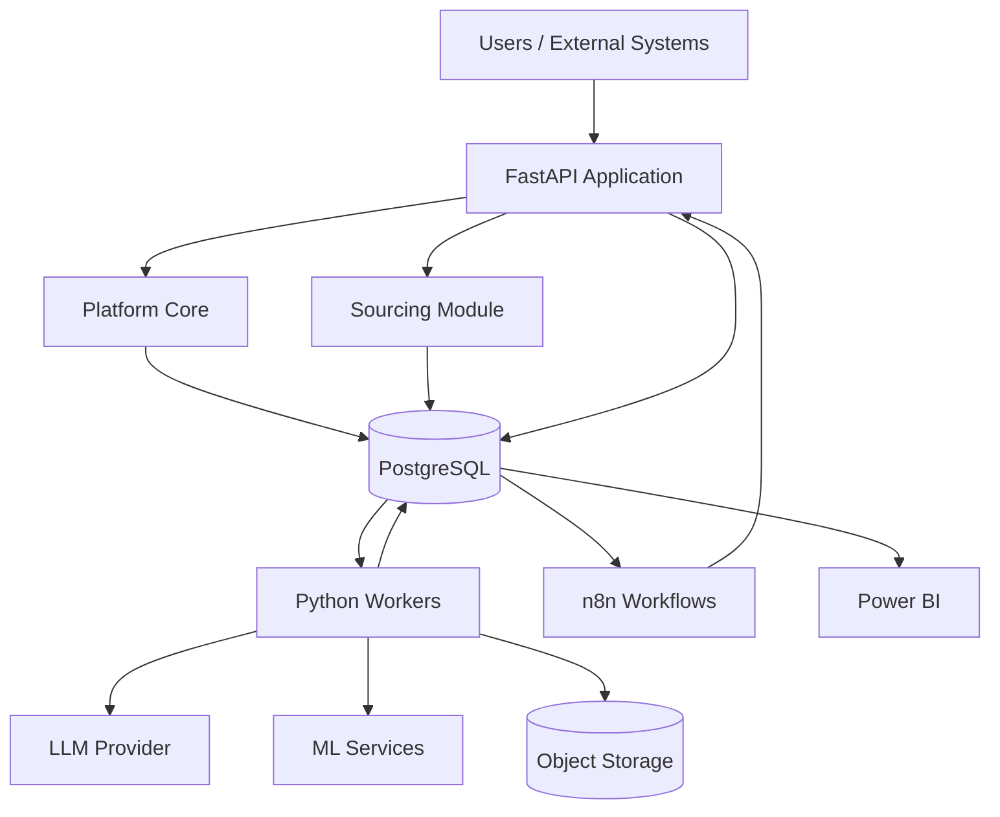
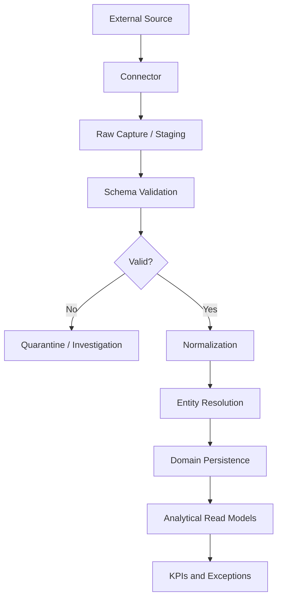
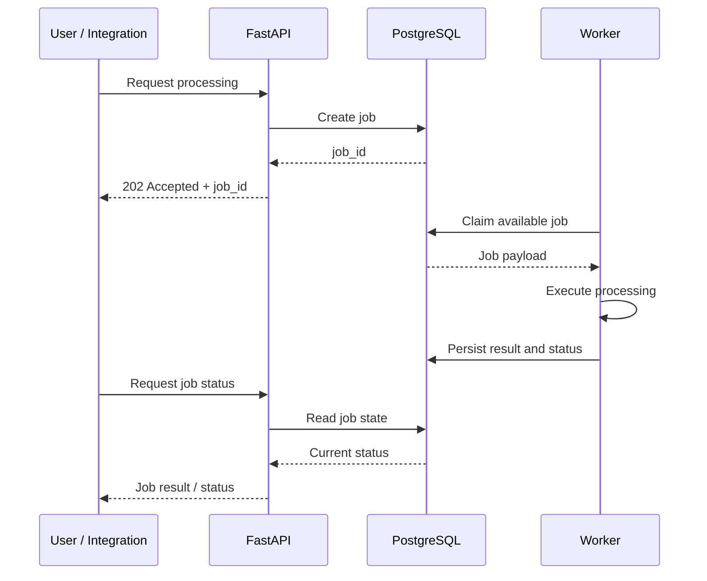
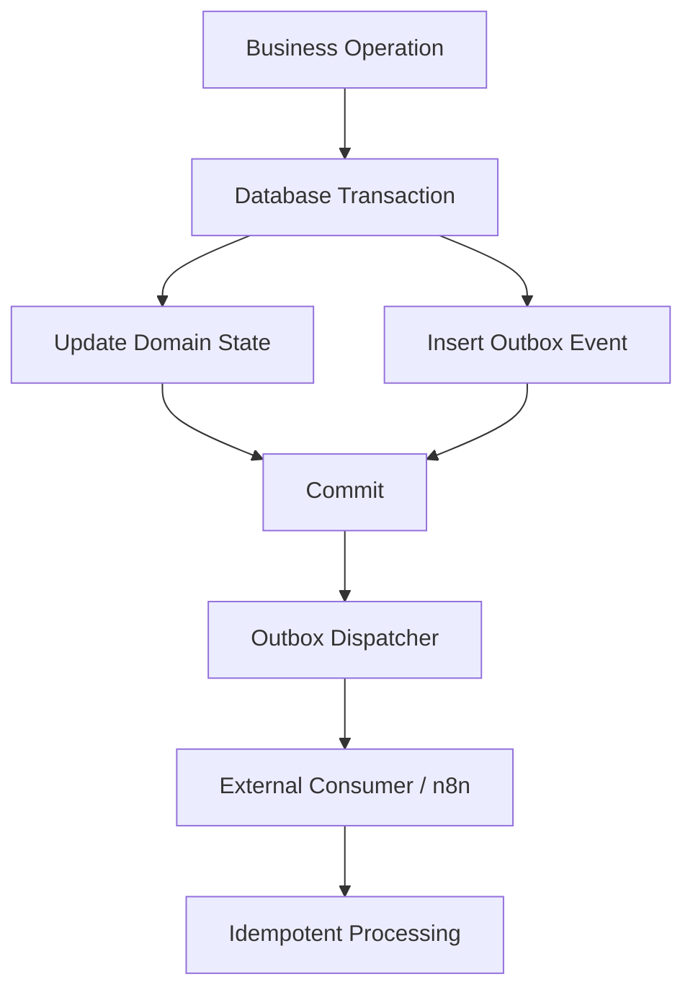
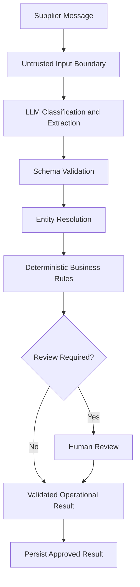
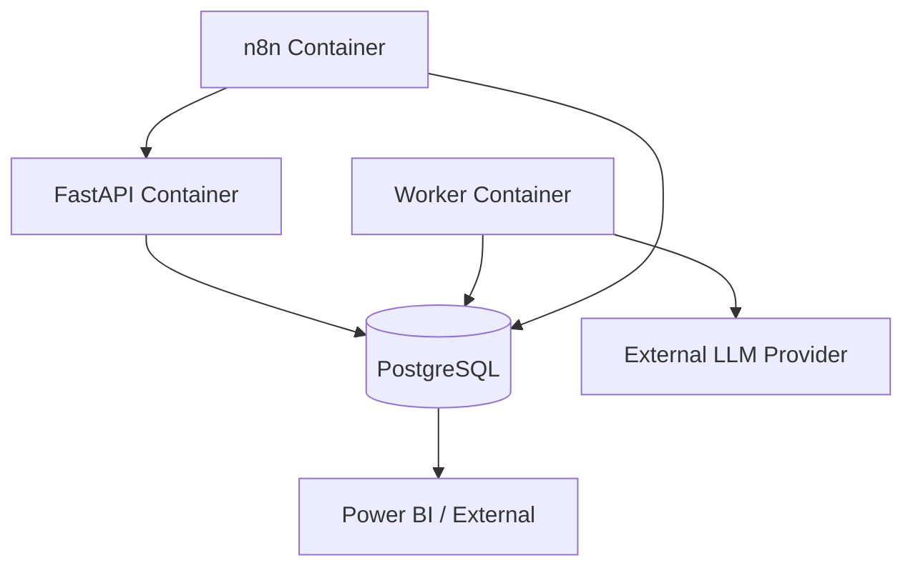

# System Design & Architecture Decision Records
## Business Operations Platform Foundation (BOPF)
### Initial Business Module: Sourcing Operations Intelligence

| Document property | Value |
|---|---|
| Document type | System Design & Architecture Decision Records |
| Product | Business Operations Platform Foundation |
| Initial module | Sourcing Operations Intelligence |
| Version | 1.1 |
| Status | Accepted architecture baseline — Part I is realized incrementally; M0 scaffolding implemented |
| Upstream documents | User Story & Problem Framing; Product Requirements Document |
| Architecture style | Domain-oriented modular monolith with independent workers |
| Initial deployment model | Single-enterprise deployment |
| Last reconciled with implementation | 2026-11-10 (M0 phase sign-off, commit `28b4ea6`) |

---

## Implementation Status (M0 Baseline)

**Reconciled:** 2026-11-10.

Part I describes the architecture the platform is being built toward. It is not a description of a complete system. As of M0, only the scaffolding baseline exists: every capability of later milestones is a design target, not implemented behavior.

| Area | M0 state |
|---|---|
| Application | FastAPI app exposing `GET /health`; the Sourcing module is mounted explicitly at `/api/v1/sourcing` with `/health` and `/status` |
| Platform Core | Configuration boundary (`src/app/core/config/`) and a SQLAlchemy engine factory (`src/app/core/database.py`); no registry, jobs, events, audit, security, or observability package |
| Persistence | Baseline migration `0001_platform_schema` creates the empty `platform` schema only; no tables, and no `sourcing` or `analytics_sourcing` schema |
| Local environment | Docker Compose with two services: `api` and `db` (PostgreSQL 16) |
| CI | GitHub Actions: Ruff format check, Ruff lint, mypy, pytest against a PostgreSQL service container |
| Quality tooling | Ruff, mypy, and pytest configured in `pyproject.toml`; locked dependencies in `uv.lock` |
| Not implemented | Module registry and lifecycle, workers, durable jobs, transactional outbox, n8n, LLM/ML integration, Power BI read models, authentication and authorization, observability instrumentation |

ADRs 001, 002, 003, 005, 007, and 012 are the decisions M0 touches; each carries an implementation-status note in Part II. ADRs 004, 006, 008, 009, 010, 011, 013, and 014 remain accepted decisions with no M0 implementation.

Sections 5 through 9 (job execution, events, connectors, AI/ML, reporting) describe capabilities with no implementation yet, as do §§11.1–11.5 (identity, authorization, audit) and §13 (observability). Where a partially implemented section could otherwise be misread, it carries an `M0 status:` note. Those notes describe the repository; they do not revise the design.

---

# Part I — System Design

## 1. Architectural Overview

### 1.1 Design Objectives

The architecture must support the product requirements while minimizing unnecessary complexity and operational failure points.

The system must:

1. Consolidate data from multiple enterprise sources.
2. Maintain clear ownership of business data and domain logic.
3. Execute long-running processing independently of API requests.
4. Provide traceable and reliable operational workflows.
5. Separate deterministic business decisions from probabilistic AI outputs.
6. Support controlled integration with external systems.
7. Allow future business modules to reuse platform capabilities.
8. Remain deployable and operable without requiring distributed infrastructure prematurely.

### 1.2 Architectural Style

BOPF uses a **domain-oriented modular monolith**, complemented by independent asynchronous workers and external workflow orchestration.

The application is deployed as a cohesive system but organized into explicit architectural boundaries.

The initial architecture avoids microservices because the expected benefits of independent service deployment and distributed ownership do not yet justify their operational cost.

The modular monolith must enforce boundaries in code, database ownership, and interfaces rather than relying only on directory organization.

### 1.3 High-Level Architecture



The diagram represents logical responsibilities rather than every physical connection. In particular, n8n interacts with business capabilities through application interfaces and approved events; it does not write directly to business tables.

### 1.4 Architectural Layers

| Layer | Responsibility |
|---|---|
| Interface Layer | HTTP API, request validation, authentication, and response contracts. |
| Platform Core | Shared platform services, module registration, configuration, jobs, audit, and integration contracts. |
| Domain Modules | Business entities, domain rules, use cases, and domain-specific analytical capabilities. |
| Execution Layer | Asynchronous jobs, data processing, AI inference, and report generation. |
| Persistence Layer | Authoritative application data, operational metadata, and analytical read models. |
| Integration Layer | Connectors, external APIs, event delivery, and workflow orchestration. |
| Presentation Layer | Operational reporting and dashboards through Power BI. |

---

## 2. Component Responsibilities

### 2.1 FastAPI Application

FastAPI provides the platform's HTTP interface.

Responsibilities:

- Authenticate and authorize requests.
- Validate request payloads.
- Expose versioned platform and module APIs.
- Initiate asynchronous jobs.
- Return job identifiers and processing status.
- Expose health and readiness endpoints.
- Provide controlled access to operational data.

The API must not execute long-running ingestion, ML, AI, or report-generation processes synchronously.

Long-running requests should return `202 Accepted` with a job reference.

### 2.2 Platform Core

Platform Core contains reusable capabilities that are independent of Sourcing business logic.

Initial responsibilities:

- Application bootstrap and configuration.
- Explicit module registry.
- Module compatibility validation.
- Shared API registration.
- Identity and access integration.
- Job execution contracts and lifecycle.
- Event and integration contracts.
- Audit and observability interfaces.
- Shared health checks.

Platform Core must not contain supplier-specific rules, procurement calculations, or Sourcing-specific workflows.

**M0 status:** only the first two items exist, in reduced form — application configuration (`src/app/core/config/`) and an explicitly constructed FastAPI app (`create_app()`), plus a SQLAlchemy engine factory. There is no registry, compatibility validation, shared API composition, identity integration, job lifecycle, event contract, audit interface, or shared health-check mechanism. The `/health` endpoint is defined directly in the application entrypoint.

**M1 Stage 6 status:** Platform Core now provides shared operational mechanisms under `src/app/core/`: structured logging (`logging/`), request and job correlation (`correlation/`), and reusable health probes (`health/`). The root `/health` liveness endpoint stays dependency-free; readiness, platform health, and module health are served through the protected platform API.

### 2.3 Sourcing Module

The Sourcing module owns the initial business domain.

Responsibilities:

- Supplier and sourcing entities.
- Requisitions, quotations, purchase orders, and deliveries.
- Domain-specific validation and reconciliation.
- Supplier performance KPI definitions.
- Deterministic exception rules.
- Supplier communication processing use cases.
- Sourcing-specific reporting definitions.
- Domain-specific approval workflows for platform-originated exceptions.

The module owns its business rules and data schema. Other modules must not depend directly on its internal implementation.

### 2.4 Python Workers

Workers execute asynchronous processing outside the API lifecycle.

Initial responsibilities:

- Data ingestion.
- Validation and normalization.
- Reconciliation.
- KPI and exception evaluation.
- Supplier communication processing.
- AI inference.
- Report generation.
- Outbox event delivery where appropriate.

Workers must be independently deployable and scalable relative to the API.

They must claim jobs safely, record execution state, and handle retries without creating duplicate business effects.

### 2.5 n8n

n8n coordinates external and cross-system workflows.

Examples:

- Scheduled report generation.
- Notification delivery.
- Integration with external services.
- Human-review notifications.
- Workflow coordination across approved APIs.

n8n does not own business calculations, approval authority, or authoritative business state.

Business state changes must be performed through application APIs.

### 2.6 PostgreSQL

PostgreSQL is the authoritative persistence layer for application-owned structured data.

It stores:

- Platform metadata.
- Sourcing domain records.
- Job execution state.
- Audit information.
- Transactional outbox records.
- Curated analytical read models.
- Report metadata.

It must preserve domain ownership through schema boundaries and restricted database permissions.

### 2.7 AI and ML Services

AI and ML capabilities are invoked through controlled application interfaces.

**LLM responsibilities:**

- Supplier communication classification.
- Structured information extraction.
- Explanatory report narratives.

**ML responsibilities:**

- Predictive or statistical anomaly detection when justified by available data.

Neither service has authority to modify business records or make final business decisions independently.

### 2.8 Power BI

Power BI provides business-facing visualization and reporting.

It consumes curated analytical read models using read-only access.

Business KPI definitions and calculations remain owned by the Sourcing domain. Power BI may implement presentation-level calculations but must not become the authoritative source for business metrics.

---

## 3. Application Structure and Module Boundaries

### 3.1 Repository Structure

Paths are relative to the repository root. This is the structure realized at M0 (2026-11-10), showing the significant paths; per-package `__init__.py` files and utility scripts are omitted.

```text
├── src/
│   └── app/
│       ├── __init__.py
│       ├── main.py                 # create_app(), platform liveness endpoint
│       ├── py.typed
│       ├── core/
│       │   ├── config/             # validated settings boundary
│       │   └── database.py         # engine factory and connection check
│       └── modules/
│           └── sourcing/
│               ├── manifest.yaml
│               ├── module.py       # typed module contract (M0 precursor)
│               └── router.py       # /api/v1/sourcing routes
├── database/
│   ├── migrations/
│   │   ├── env.py
│   │   ├── script.py.mako
│   │   └── versions/
│   │       └── 0001_platform_schema.py
│   └── schemas/
├── tests/
│   ├── conftest.py
│   ├── test_app.py
│   ├── test_config.py
│   ├── test_database.py
│   └── test_package.py
├── reports/
│   ├── docs/                       # grounding, architecture, roadmap, phase records
│   └── figures/
├── data/                           # sample and synthetic datasets
├── evaluation/                     # LLM and ML evaluation scaffolding
├── infrastructure/docker/
├── powerbi/dashboards/
├── workflows/n8n/
├── .github/workflows/ci.yml
├── alembic.ini
├── docker-compose.yml
├── Dockerfile
├── .dockerignore
├── .env.example
├── .gitignore
├── .pre-commit-config.yaml
├── dvc.yaml
├── params.yaml
├── pyproject.toml
├── uv.lock
├── invariants.md
└── README.md
```

The realized tree is a subset of the target structure. The following are introduced by their owning milestone, not created as placeholders:

- `src/app/core/bootstrap.py` and `src/app/api/` — platform API foundation (M1).
- `src/app/core/{registry,security,jobs,events,audit,observability}/` — platform capabilities (M1).
- `src/app/workers/` — independent worker execution (M1).
- Module subpackages `api/`, `domain/`, `application/`, `infrastructure/`, `analytics/`, `ai/`, `ml/`, `workflows/`, `tests/` — introduced as the Sourcing features they serve are implemented (M1 onward).

Directories and abstractions are created when the corresponding functionality is implemented, not in advance.

### 3.2 Module Manifest

Each business module must declare its identity and compatibility requirements through an explicit manifest.

Illustrative example:

```yaml
id: sourcing
name: Sourcing Operations Intelligence
version: 1.0.0

platform:
  minimum_version: 1.0.0

database:
  schema: sourcing
  migrations: database/migrations

capabilities:
  - suppliers
  - requisitions
  - quotations
  - purchase_orders
  - deliveries
  - exceptions
  - reporting

permissions:
  - sourcing.read
  - sourcing.manage
  - sourcing.approve
```

The manifest describes module capabilities and requirements. It does not authorize arbitrary code execution or unrestricted dynamic imports.

**M0 status:** the committed manifest (`src/app/modules/sourcing/manifest.yaml`) declares version `0.1.0`, `platform.minimum_version: 0.1.0`, `database.migrations: database/migrations`, the single capability `health`, and the single permission `sourcing.read`. The capability and permission lists above are the target set, introduced capability by capability as their features are implemented.

**M1 Stage 1 status:** manifests are loaded into a closed, immutable Pydantic schema and validated at registration for required fields, identity format, strict semver, unique qualified capabilities and permissions, and minimum platform compatibility. Manifest presence alone still grants no execution rights. Durable registration records are implemented in Stage 2.

**M1 Stage 2 status:** each registration carries a deterministic manifest hash, so a persisted record shows which manifest content was validated. The hash is platform-computed metadata, not an authorization signal.

### 3.3 Module Contract

Every registered module must implement a typed contract that supports:

- Module identity and version.
- Compatibility validation.
- API route registration.
- Permission declaration.
- Health checks.
- Lifecycle operations.
- Relevant integration or event-handler registration.

Registration must be explicit and validated during application bootstrap.

**M0 status:** the Sourcing contract implements module identity, name, version, and a health status interface, and `create_app()` mounts the module router explicitly. Compatibility validation, permission declaration and enforcement, lifecycle operations, and event-handler registration do not exist yet.

**M1 Stage 1 status:** `BusinessModuleContract` defines manifest, router, health, permissions, and capabilities. Sourcing implements the full contract, and `create_app()` composes routes from active registry entries. Permission enforcement and event-handler registration remain later-stage scope.

### 3.4 Module Lifecycle

The platform supports the following lifecycle:

1. Discovery.
2. Manifest validation.
3. Compatibility validation.
4. Database migration validation or execution through the controlled migration process.
5. Module registration.
6. Activation.
7. Deactivation.

Installation must be idempotent.

Deactivation must not delete business data.

Database migrations must be executed through a controlled deployment process rather than automatically by every API or worker startup.

**M0 status:** no lifecycle stage is implemented. The application mounts the Sourcing router directly; there is no discovery, manifest validation, compatibility check, or activation/deactivation. Migrations are operator-invoked through Alembic only, and API startup never creates or alters schema (INV-015). The registry and lifecycle are M1 scope (ADR-007).

**M1 Stage 1 status:** discovery is replaced by an explicit code-defined allowlist. Registration validates manifest, compatibility, and contract conformance; active, failed, and inactive states are observable; deactivation preserves data. Migrations remain operator-invoked.

**M1 Stage 2 status:** registration state can be persisted in `platform.module_registrations` through `SqlAlchemyModuleRegistrationStore`, including hash and diagnostics for failed or inactive modules. Runtime startup still defaults to the in-memory store; durable registration is activated with API/worker composition in Stage 4/5.

---

## 4. Data Architecture

### 4.1 Database Strategy

The initial system uses PostgreSQL with logical schema separation.

| Schema | Responsibility |
|---|---|
| `platform` | Module metadata, job execution, platform configuration metadata, audit, and outbox. |
| `sourcing` | Sourcing domain entities and operational state. |
| `analytics_sourcing` | Curated read models and reporting-oriented data. |
| Future schemas | `finance`, `inventory`, `logistics`, and other business domains. |

**M0 status:** only the `platform` schema exists. Baseline migration `0001_platform_schema` creates it empty — no tables. `sourcing` and `analytics_sourcing` do not exist yet: `platform` tables arrive in M1, and module schemas arrive with their modules' own migrations (INV-015).

n8n should use a separate database and credentials. It may share the same PostgreSQL server initially, but must not share application tables or write access.

An MLflow tracking store, if introduced, must have a clearly separate ownership boundary.

### 4.2 Persistence Ownership

| Data | Owner |
|---|---|
| Supplier and purchase order operational representations | Sourcing |
| Job execution metadata | Platform Core |
| Module registry | Platform Core |
| Audit events | Platform Core |
| Transactional outbox | Platform Core |
| Sourcing KPI definitions and results | Sourcing |
| Sourcing analytical read models | Sourcing / Analytics |
| n8n execution state | n8n |

Schema separation must be reinforced by database permissions.

Applications should use explicit database roles and restricted grants. Avoid unsafe writable `search_path` configurations.

### 4.3 Core Domain Entities

The initial Sourcing domain includes:

- Supplier
- Requisition
- Quote
- PurchaseOrder
- Delivery
- SupplierMessage
- Exception
- Alert
- Approval

Relationships must use validated identifiers and explicit reconciliation outcomes.

### 4.4 Ingestion Data Flow



The platform must distinguish:

- Data as received.
- Data that passed structural validation.
- Data that has been normalized.
- Data whose business relationships have been confirmed.
- Data that is available for authoritative calculations.

An ambiguous entity match must not silently become a confirmed relationship.

### 4.5 Data Provenance

Imported records must preserve relevant metadata:

- Source identifier.
- External record identifier.
- Ingestion batch or execution ID.
- Source timestamp, when available.
- Processing timestamp.
- Validation outcome.
- Source reference.

This information is essential for reconciliation, auditability, and report traceability.

### 4.6 Analytical Read Models

The `analytics_sourcing` schema contains curated, reporting-oriented representations.

Examples:

- Supplier performance by period.
- Delivery performance.
- Exception summaries.
- Requisition and purchase order operational status.
- Reporting snapshots.

Read models are derived from authoritative domain data. They must not become independent sources of business truth.

---

## 5. Job Execution Architecture

### 5.1 Execution Model

The API and worker processes are independent.



### 5.2 Job Lifecycle

Initial job states:

| State | Meaning |
|---|---|
| QUEUED | Accepted and awaiting execution. |
| RUNNING | Currently being processed. |
| SUCCEEDED | Completed successfully. |
| FAILED | Failed and requires intervention or final failure handling. |
| NEEDS_REVIEW | Requires an authorized human decision. |
| RETRY_SCHEDULED | Eligible for another execution attempt. |
| CANCELLED | Cancelled through an authorized operation. |

The state model must define valid transitions. A job must not move directly from a terminal state back to RUNNING without an explicit new execution or recovery procedure.

### 5.3 Job Persistence

The initial job system uses PostgreSQL.

The job record should include:

- Job ID.
- Job type.
- Payload or payload reference.
- Current status.
- Idempotency key.
- Correlation ID.
- Attempt count.
- Created, started, and completed timestamps.
- Error classification and relevant error metadata.
- Result reference, where applicable.

Attempt history should be persisted separately or represented through a suitable execution-history structure.

**M1 Stage 2 status:** implemented. `0002_platform_jobs_and_metadata` creates `platform.jobs`, `platform.job_attempts`, and `platform.idempotency_keys`; `JobStore` supports submission, read, guarded status updates, `FOR UPDATE SKIP LOCKED` claiming, and stale-lease recovery.

**M1 Stage 5 status:** complete. The approved lifecycle graph is enforced in `src/app/core/persistence/job_state.py` and by `JobStore.update_job_status`; retry scheduling uses the approved bounded backoff (30s → 120s → 480s). Worker-side orchestration, handler dispatch, attempt recording, and stale-lease recovery run in `src/app/workers/` (`runner.py`, `dispatcher.py`, `sweeper.py`).

### 5.4 Worker Concurrency

Workers claim available jobs using PostgreSQL transactions and row-level locking, with `FOR UPDATE SKIP LOCKED` as the initial concurrency strategy.

The claim and state transition must be atomic.

Long-running processing must not hold a database transaction open for its entire duration.

### 5.5 Reliability Requirements

The job system must handle:

- Duplicate job submissions.
- Duplicate execution attempts.
- Worker process crashes.
- Expired credentials.
- Transient integration failures.
- Database interruptions.
- Invalid payloads.
- Non-recoverable business validation errors.

Retries must use bounded attempts and appropriate backoff.

Idempotency must be enforced at the business-effect boundary, not merely by checking whether a job ID already exists.

A worker crash after an external side effect but before recording completion must not automatically repeat that side effect without reconciliation or idempotency protection.

### 5.6 Initial Queue Technology

PostgreSQL is sufficient for the initial job queue.

Redis, RabbitMQ, or other dedicated messaging infrastructure should only be introduced if measured throughput, contention, latency, or operational requirements justify it.

---

## 6. Event and Integration Architecture

### 6.1 Transactional Outbox

Business state changes and their corresponding integration events must be recorded in the same database transaction.

The transactional outbox avoids the inconsistency of updating business state successfully while failing to publish the corresponding event.



### 6.2 Event Envelope

Versioned events should contain:

```json
{
  "event_id": "uuid",
  "event_type": "sourcing.exception.created",
  "event_version": 1,
  "occurred_at": "2026-11-05T12:00:00Z",
  "producer": "sourcing",
  "correlation_id": "uuid",
  "subject": "exception-id",
  "payload": {}
}
```

Payloads must contain only the information necessary for the consumer. Sensitive information should not be copied into events unnecessarily.

### 6.3 Delivery Semantics

Event delivery is at least once.

Consumers must be idempotent because the same event may be delivered more than once.

The initial implementation may use PostgreSQL outbox records and controlled HTTP delivery. Kafka or another distributed event broker is not required.

### 6.4 Integration Boundary

External integrations must use explicit connectors or application interfaces.

n8n may:

- Receive approved events.
- Coordinate scheduled operations.
- Invoke application endpoints.
- Deliver notifications.
- Coordinate external workflow steps.

n8n must not:

- Write directly to Sourcing domain tables.
- Reimplement authoritative KPI calculations.
- Override application authorization.
- Treat email delivery as evidence of approval.
- Execute unvalidated LLM instructions.

---

## 7. Connector Architecture

### 7.1 Connector Contract

Connectors provide a consistent interface for supported data sources.

The contract should cover:

- Connection and authentication.
- Source configuration.
- Data retrieval.
- Pagination.
- Rate-limit handling.
- Timeouts.
- Error classification.
- Source metadata.
- Execution reporting.

### 7.2 Initial Connector Types

| Connector | Initial purpose |
|---|---|
| CSV / XLSX | Import reference sourcing datasets. |
| PostgreSQL | Read authorized structured source data. |
| REST API | Retrieve data from supported enterprise interfaces. |
| Email | Simulated initially; real mailbox integration requires authorization. |

### 7.3 Connector Responsibilities

Connectors retrieve and translate external data into a standardized ingestion representation.

They must not own Sourcing business decisions or silently discard invalid data.

Business validation and reconciliation belong to the application/domain processing layers.

---

## 8. AI and ML Architecture

### 8.1 AI Provider Gateway

LLM access must be mediated by a controlled provider interface.

Responsibilities:

- Provider and model configuration.
- Structured output enforcement.
- Timeout and retry policies.
- Usage and cost tracking.
- Model and provider version tracking.
- Error classification.
- Execution traceability.

The initial implementation should use one provider. Provider independence is a design boundary, not a requirement to implement complex multi-provider routing immediately.

### 8.2 Supplier Communication Processing



The LLM output is a candidate interpretation, not an authoritative business fact.

The workflow must preserve the original communication reference and distinguish extracted values from validated and approved information.

### 8.3 AI Decision Boundaries

| Operation | Responsible component |
|---|---|
| Classify supplier communication | LLM |
| Extract dates, prices, quantities, and references | LLM |
| Validate output structure | Application validation |
| Resolve business identifiers | Deterministic domain logic |
| Calculate KPI | Sourcing domain |
| Evaluate SLA | Sourcing domain |
| Compare prices and quantities | Sourcing domain |
| Determine exception thresholds | Deterministic policy |
| Authorize approval | Identity and access + domain policy |
| Explain validated indicators | LLM |
| Approve consequential business action | Authorized human |

### 8.4 Human-in-the-Loop

Human review must be enforced at the application/business-policy boundary.

An LLM cannot bypass the review requirement by returning a high confidence score.

The platform must distinguish:

- Automatic technical processing.
- AI-generated suggestions.
- Validated business facts.
- Human-approved outcomes.

### 8.5 ML Architecture

Anomaly detection begins with deterministic historical baselines.

If sufficient historical data exists and a candidate model demonstrates measurable improvement, the platform may introduce an ML inference component.

DVC may be introduced for dataset and pipeline versioning when predictive modeling is implemented.

MLflow may complement it for experiment tracking and model lifecycle management.

Neither is a mandatory dependency for the initial platform scaffolding.

---

## 9. Reporting Architecture

### 9.1 Report Generation

The report-generation workflow is an asynchronous application use case.

It must:

1. Validate the report request and reporting period.
2. Retrieve the appropriate validated analytical data.
3. Calculate authoritative KPIs.
4. Retrieve material exceptions and supporting evidence.
5. Establish a consistent data snapshot or cutoff.
6. Generate optional explanatory narrative.
7. Validate narrative consistency against the authoritative results.
8. Persist report metadata and generation status.
9. Make the report available to authorized users or an approved distribution workflow.

### 9.2 Report Traceability

Every report must retain:

- Report type.
- Reporting period.
- Data cutoff timestamp.
- Generation execution ID.
- Relevant KPI definitions or versions.
- Supporting evidence references.
- Generation status.
- Artifact reference, if applicable.

### 9.3 Power BI Integration

Power BI consumes curated analytical read models through read-only credentials.

Refresh frequency must reflect reporting needs and source-data freshness.

The platform should avoid triggering a dashboard refresh for every underlying business event.

Power BI is the presentation layer, not the authoritative business calculation engine.

---

## 10. API Design

### 10.1 API Versioning

Initial API namespace:

- `/api/v1/platform/...`
- `/api/v1/sourcing/...`

Versioning applies to externally consumed contracts.

**M0 status:** `GET /health` is served at the application root, not under `/api/v1/platform/`; the versioned platform namespace is introduced with the M1 platform API. `/api/v1/sourcing/` is mounted at the designed prefix.

### 10.2 Initial Endpoint Inventory

This is the target contract inventory. The `M0 state` column records what exists in the repository today.

| Endpoint | Purpose | M0 state |
|---|---|---|
| `GET /health` | Platform liveness. | Implemented (root path) |
| `GET /api/v1/sourcing/health` | Sourcing module liveness. | Implemented |
| `GET /api/v1/sourcing/status` | Sourcing module operational status. | Implemented |
| `GET /api/v1/platform/health` | Platform health under the versioned namespace. | Not implemented (M1) |
| `GET /api/v1/platform/modules` | Registered module information. | Not implemented (M1) |
| `GET /api/v1/platform/jobs/{job_id}` | Job status and result reference. | Not implemented (M1) |
| `POST /api/v1/sourcing/ingestions` | Initiate data ingestion. | Not implemented (M2) |
| `GET /api/v1/sourcing/ingestions/{job_id}` | Retrieve ingestion status. | Not implemented (M2) |
| `GET /api/v1/sourcing/suppliers` | Retrieve suppliers. | Not implemented (M2) |
| `GET /api/v1/sourcing/requisitions` | Retrieve requisitions. | Not implemented (M2) |
| `GET /api/v1/sourcing/quotes` | Retrieve quotations. | Not implemented (M2) |
| `GET /api/v1/sourcing/purchase-orders` | Retrieve purchase orders. | Not implemented (M2) |
| `GET /api/v1/sourcing/deliveries` | Retrieve deliveries. | Not implemented (M2) |
| `GET /api/v1/sourcing/exceptions` | Retrieve operational exceptions. | Not implemented (M2) |
| `GET /api/v1/sourcing/exceptions/{id}` | Retrieve exception details. | Not implemented (M2) |
| `POST /api/v1/sourcing/exceptions/{id}/decisions` | Record an authorized exception decision. | Not implemented (M2+) |
| `POST /api/v1/sourcing/reports` | Initiate report generation. | Not implemented (M3) |
| `GET /api/v1/sourcing/reports/{job_id}` | Retrieve report-generation status. | Not implemented (M3) |

Request schemas, response schemas, pagination, filtering, and error formats will be specified during implementation.

**M1 Stage 6 status:** `GET /health` remains public liveness. The authenticated platform endpoints now include `GET /api/v1/platform/health` (critical-dependency health; 503 when PostgreSQL is unreachable), `GET /api/v1/platform/readiness` (database and registry readiness; 503 when not ready), `GET /api/v1/platform/modules`, and `GET /api/v1/platform/modules/{module_id}/health`. Health and readiness require `platform.health.read`; module inspection and module health require `platform.modules.read`. The `M0 state` column above is retained as the original baseline record.

### 10.3 API Behavior

Long-running operations return:

- HTTP `202 Accepted`.
- A unique job identifier.
- A status resource reference.
- A correlation identifier where applicable.

Synchronous endpoints should remain limited to operations with predictable, bounded execution times.

### 10.4 Error Handling

The API should expose consistent error responses with:

- Machine-readable error code.
- Human-readable message.
- Correlation ID.
- Relevant validation details.
- Retryability indication where appropriate.

Internal stack traces, credentials, and sensitive implementation details must not be exposed to API consumers.

---

## 11. Identity, Security, and Governance

### 11.1 Authentication

The production architecture should support standards-based authentication through OIDC/OAuth2.

JWT-based authorization may be used for API requests, with service-to-service authentication for workers and integrations.

Local development may use a simplified authentication configuration, but production security boundaries must remain explicit.

### 11.2 Authorization

Initial roles:

- Platform Administrator.
- Operations Analyst.
- Operations Manager.
- Executive Viewer.
- Integration Service.

Permissions must be evaluated at the application boundary.

Module-specific permissions must be declared and enforced explicitly.

**M1 Stage 3 status:** implemented. `src/app/core/security/` establishes the provider-neutral authentication boundary (`TokenValidator`, `AuthenticatedIdentity`), canonical role-to-permission mapping (`CanonicalRole`, `ROLE_PERMISSIONS`), and central enforcement factory (`require_permission`). Sourcing routes enforce `sourcing.read`. Test token usage is strictly blocked in production mode (INV-016).

### 11.3 Secrets Management

- Local development may use environment-based configuration.
- `.env` files must not be committed.
- Production secrets must be stored in a managed secret store.
- Database and integration credentials must use least-privilege access.
- Secrets must not appear in logs, events, or error messages.

### 11.4 Data Protection

Production data must be protected through appropriate encryption, access restrictions, retention policies, and audit controls.

Supplier communications are untrusted external content and may contain malicious instructions.

LLM input handling must preserve a strict separation between data interpretation and executable system instructions.

### 11.5 Audit

The platform must distinguish:

- Technical logs.
- Job execution history.
- Business audit events.
- AI evaluation and execution records.

Approval and other consequential actions must record the responsible identity, timestamp, decision, and relevant evidence.

---

## 12. Deployment Architecture

### 12.1 Local Development

Docker Compose provides the initial local deployment environment.



n8n must use a separate database and restricted credentials. Its connection to the application database is limited to approved integration mechanisms; direct business-table writes are prohibited.

Target services:

- API.
- Worker.
- PostgreSQL.
- n8n.

**M0 status:** the implemented stack is `api` and `db` only, defined in `docker-compose.yml`. The worker, n8n, and the LLM provider shown in the diagram are targets introduced in later milestones; no container or configuration exists for them.

**M1 Stage 5 status:** a `worker` service now exists in `docker-compose.yml`, built from the same image and running `python -m app.workers.runner` with a `db` health dependency. n8n and the LLM provider remain targets.

Optional services should be introduced only when required.

### 12.2 Staging

Staging should reproduce the production architecture as closely as practical.

It must use:

- Synthetic or anonymized datasets.
- Separate credentials.
- Controlled integration endpoints.
- Deployment validation.
- Migration testing.
- Security and operational checks.

### 12.3 Production — AWS Reference Architecture

| Component | AWS service |
|---|---|
| API and workers | ECS Fargate |
| HTTP entry point | Application Load Balancer |
| Application database | Amazon RDS for PostgreSQL |
| File and artifact storage | Amazon S3 |
| Container registry | Amazon ECR |
| Secrets | AWS Secrets Manager |
| Workload permissions | IAM |
| Logs and metrics | Amazon CloudWatch |
| CI/CD | GitHub Actions |
| Workflow orchestration | n8n deployment |

API and worker tasks should be independently deployable and scalable.

Database migrations must be executed through a controlled release step, not automatically during application startup.

### 12.4 Deployment Evolution

The architecture should evolve based on demonstrated operational needs.

Do not introduce Kubernetes, microservices, dedicated brokers, or additional infrastructure merely because they are common in enterprise architectures.

---

## 13. Observability and Operational Management

### 13.1 Operational Metrics

The initial observability baseline should include:

| Area | Metrics |
|---|---|
| API | Request volume, error rate, latency. |
| Jobs | Queue depth, processing duration, retries, failures. |
| Ingestion | Execution success, record counts, validation failures. |
| Integrations | Request failures, timeouts, rate-limit events. |
| Outbox | Pending events, delivery failures, delivery lag. |
| AI | Execution failures, latency, token usage, cost. |
| Reporting | Generation success, duration, correction rate. |
| Data quality | Unlinked records, duplicates, validation failures. |

### 13.2 Correlation

A correlation ID should connect related API requests, jobs, worker executions, integration events, and relevant workflow operations.

This enables diagnosis across asynchronous processing boundaries.

**Implementation status (M1 Stage 6, 2026-11-13):** correlation is implemented as a context variable shared by the API and worker. The HTTP middleware accepts or generates the identifier, echoes `X-Correlation-ID` (`X-Request-ID` is accepted as an alias), binds it for the request scope, and the submission handler persists it on the job. The worker re-binds the persisted value for the execution scope, and every structured event emitted in that scope carries `correlation_id`. Correlation is trace-only and is never used for authorization.

### 13.3 Logging

**Implementation status (M1 Stage 6, 2026-11-13):** both processes use one `structlog` configuration that emits one JSON object per event outside `local`, including logs produced by standard-library loggers such as uvicorn and SQLAlchemy. Events carry timestamp, level, service, and the active correlation ID. A recursive field-name redaction processor removes credentials and secrets; request headers, bodies, and job payloads are never logged.

### 13.4 Failure Handling

The system must distinguish:

- Transient infrastructure failures.
- External provider failures.
- Authentication and authorization failures.
- Invalid input.
- Business-rule rejection.
- Human-review requirements.

Retry policies must be appropriate to the failure type.

### 13.5 n8n Operational Controls

n8n execution history is not the platform's permanent business audit ledger.

Execution retention and pruning must be configured.

The application remains responsible for durable business state and audit information.

---

## 14. Testing and Quality Strategy

### 14.1 Test Layers

| Test type | Objective |
|---|---|
| Unit tests | Validate domain rules, calculations, and individual components. |
| Integration tests | Validate persistence, API behavior, and external integration contracts. |
| Contract tests | Validate API and event compatibility. |
| Architecture tests | Detect forbidden dependencies and boundary violations. |
| End-to-end tests | Validate important operational workflows. |
| Security tests | Validate access controls, input handling, and dependency security. |
| AI evaluations | Measure classification, extraction, and narrative quality. |
| Failure tests | Validate retry, recovery, idempotency, and operational resilience. |

### 14.2 Mandatory Failure Scenarios

The initial system should test:

- Duplicate ingestion requests.
- Duplicate source records.
- Unknown purchase order references.
- Ambiguous supplier matching.
- Expired integration credentials.
- Worker interruption during processing.
- Duplicate report requests.
- Malformed LLM output.
- LLM provider timeouts.
- API rate limits.
- Duplicate event delivery.
- Database outage.
- Unauthorized approval attempts.

### 14.3 Engineering Quality Gates

The CI pipeline should include the following. The `M0 state` column records what runs today.

| Gate | M0 state |
|---|---|
| Ruff linting and formatting checks | Implemented |
| Pytest | Implemented, including PostgreSQL connectivity and migration checks |
| Static typing checks (`mypy`, strict) | Implemented |
| Schema and data validation tests | Not in CI |
| Dependency vulnerability scanning | Deferred |
| Container image scanning where applicable | Deferred |
| Architecture boundary tests | Not implemented |

**M0 status:** `.github/workflows/ci.yml` runs Ruff format check, Ruff lint, `mypy src tests`, and `pytest` on Python 3.11 with a PostgreSQL 16 service container. Coverage thresholds, dependency and container scanning, and multi-version matrices are deliberately excluded under M0-D07 until the codebase or risk justifies them.

The objective is to prevent regressions and detect unsafe or incomplete implementations before deployment.

---

# Part II — Architecture Decision Records

## ADR-001 — Modular Monolith

**Status:** Accepted

### Context

BOPF needs multiple business modules with shared infrastructure, but the initial deployment serves one enterprise scenario.

Microservices would introduce additional deployment, communication, observability, and operational complexity without demonstrated need.

### Decision

Adopt a domain-oriented modular monolith with explicit module boundaries.

### Alternatives considered

- Microservices.
- Traditional monolithic application without enforced domain boundaries.
- Distributed modular architecture.

### Consequences

- Simpler initial deployment and debugging.
- Shared infrastructure can be reused.
- Domain boundaries must be enforced through code, interfaces, and database permissions.
- Individual modules cannot be independently deployed initially.
- Future extraction into services remains possible if justified.

**Implementation status (M0, 2026-11-10):** realized. One FastAPI deployable under `src/app/`, with `core` and `modules` separated in code and a single module mounted. No worker process exists, so the "with independent workers" half of the style is not yet in operation.

**Implementation status (M1 Stage 5, 2026-11-13):** the "with independent workers" half is now in operation. `src/app/workers/` provides a separately started process (API + worker + PostgreSQL), sharing `core` contracts without importing the API application.

**Implementation status (M1 Stage 4, 2026-11-12):** core platform API is mounted under `/api/v1/platform` (`/health`, `/modules`, `/jobs`), strictly separated from domain module routes (`/api/v1/{module_id}`). Request correlation is preserved across the application lifecycle.

---

## ADR-002 — Domain-Oriented Business Modules

**Status:** Accepted

### Context

Future domains such as Finance, Inventory, and Logistics should reuse the platform without coupling their business logic to Sourcing.

### Decision

Organize business functionality into explicit domain modules.

Each module owns its domain entities, business rules, APIs, analytical definitions, and integrations.

### Alternatives considered

- One shared business domain.
- Functional packages organized only by technical layer.
- Independent services for each domain.

### Consequences

- Clear domain ownership.
- Improved maintainability and extensibility.
- Shared capabilities remain in Platform Core.
- Cross-module interactions require explicit contracts.

**Implementation status (M0, 2026-11-10):** realized for one module. `src/app/modules/sourcing/` owns its manifest, contract, and router; Platform Core holds only configuration and database concerns. No second module exists to test the boundary.

**Implementation status (M1 Stage 3, 2026-11-12):** module permissions are enforced at the application boundary. Sourcing module routes (`/api/v1/sourcing/health`, `/api/v1/sourcing/status`) require the module-declared `sourcing.read` permission via `require_permission`.

---

## ADR-003 — PostgreSQL as Primary Application Database

**Status:** Accepted

### Context

The initial platform needs transactional persistence for domain records, jobs, audit, events, and analytical read models.

### Decision

Use PostgreSQL as the primary application database with schema-level domain separation.

Initial schemas:

- `platform`
- `sourcing`
- `analytics_sourcing`

n8n uses a separate database and credentials.

### Alternatives considered

- Multiple database technologies from the beginning.
- Separate database servers per module.
- NoSQL-first architecture.

### Consequences

- Reduced infrastructure complexity.
- Transactional consistency across relevant application operations.
- Database ownership must be enforced through schemas and permissions.
- Scaling and storage decisions can evolve as workload evidence accumulates.

**Implementation status (M0, 2026-11-10):** partially realized. One PostgreSQL 16 instance is used for local development and CI. The baseline migration creates only the empty `platform` schema; `sourcing` and `analytics_sourcing` are not created until the features that own them are implemented. Schema separation is therefore a design intent, not yet an enforced boundary. Migrations are operator-invoked and version-controlled (INV-015).

**Implementation status (M1 Stage 2, 2026-11-12):** `0002_platform_jobs_and_metadata` adds the platform-owned registration, job, attempt, and idempotency tables. No business schema exists yet. Verification runs the migration against disposable databases only; applying it to a deployed database remains an operator step.

---

## ADR-004 — n8n for External Workflow Orchestration

**Status:** Accepted

### Context

The product needs scheduled reporting, notifications, and integrations with external services.

These workflows should not become embedded in domain business logic.

### Decision

Use n8n as the external workflow orchestration layer.

Business operations remain exposed through application APIs and approved events.

### Alternatives considered

- Implement all workflows directly in Python.
- Introduce a custom orchestration engine.
- Adopt a distributed workflow platform immediately.

### Consequences

- Faster implementation of integration workflows.
- Separation between domain logic and external coordination.
- n8n execution history is not the authoritative business audit ledger.
- Direct database writes by n8n are prohibited.
- Queue mode and additional infrastructure are introduced only if justified.

---

## ADR-005 — Independent Python Worker Process

**Status:** Accepted

### Context

Data ingestion, AI inference, and report generation may exceed acceptable API request durations.

### Decision

Run asynchronous workloads in independent Python worker processes.

The API creates durable jobs and returns execution identifiers.

Workers claim and execute jobs independently.

### Alternatives considered

- Synchronous processing inside FastAPI.
- Background tasks tied to API process lifetime.
- Dedicated external job platform from the beginning.

### Consequences

- API responsiveness is independent of long-running processing.
- Worker processes can scale separately.
- Job state and recovery must be designed explicitly.
- PostgreSQL is sufficient for the initial queue implementation.

**Implementation status (M0, 2026-11-10):** not implemented. There is no worker process, no job table, and no claim or retry mechanism. M0 delivers an API-only composition; this decision becomes actionable in M1, where worker execution and durable job state are introduced.

**Implementation status (M1 Stage 2, 2026-11-12):** durable job state and atomic claiming are implemented in `JobStore` with `FOR UPDATE SKIP LOCKED`. The independent worker process still only initializes; claiming loop, dispatch, and retry orchestration are Stage 5.

**Implementation status (M1 Stage 4, 2026-11-12):** asynchronous job submission boundary is operational at `POST /api/v1/platform/jobs` and `GET /api/v1/platform/jobs/{job_id}`. Submissions persist immediately into `QUEUED` status and return HTTP 201 without blocking on execution (INV-008); worker claiming loop and handler execution follow in Stage 5.

**Implementation status (M1 Stage 5, 2026-11-13):** realized. `src/app/workers/runner.py` is an independent process that initializes through the shared bootstrap, claims jobs with `FOR UPDATE SKIP LOCKED`, executes registered handlers outside the claim transaction, records attempts, schedules bounded retries, and recovers expired `RUNNING` leases through `src/app/workers/sweeper.py`. The worker is a separate Docker Compose service (`worker`) and has no dependency on the API process. Controlled SIGKILL falsification remains pending for Stage 7.

---

## ADR-006 — Transactional Outbox for Event Publication

**Status:** Accepted

### Context

Business operations may need to publish events to external workflows.

Updating domain state and publishing an event separately creates a risk of inconsistent outcomes.

### Decision

Persist business state changes and corresponding outbox events in the same database transaction.

An independent dispatcher delivers events to consumers.

### Alternatives considered

- Direct event publication inside business transactions.
- Database polling by external systems.
- Distributed event broker from the beginning.

### Consequences

- Improved consistency between domain state and event publication.
- At-least-once delivery must be expected.
- Consumers must implement idempotency.
- Event retention and outbox cleanup must be managed.

---

## ADR-007 — Explicit Module Registry

**Status:** Accepted

### Context

The platform must discover and register business modules while avoiding unrestricted dynamic code loading.

### Decision

Use an explicit module registry with validated manifests and typed module contracts.

Only modules included in the approved registry may be activated.

### Alternatives considered

- Automatic package discovery and unrestricted imports.
- Plugin loading from arbitrary paths.
- Hardcoded routing without a module lifecycle.

### Consequences

- Controlled module activation.
- Predictable startup behavior.
- Compatibility can be validated before registration.
- New modules require explicit registration and review.

**Implementation status (M0, 2026-11-10):** precursor only. `create_app()` mounts the Sourcing router explicitly, and the module exposes a frozen dataclass contract with identity and health status. There is no registry, no manifest loading or validation, no compatibility check, and no activation lifecycle. The M0 implementation deliberately stops short of the registry to avoid pre-implementing M1.

**Implementation status (M1 Stage 2, 2026-11-12):** the registry, manifest validation, compatibility checks, and lifecycle are implemented. Registration state has a durable SQLAlchemy-backed store; runtime composition still defaults to in-memory registration until Stage 4/5.

---

## ADR-008 — Provider-Independent LLM Integration

**Status:** Accepted

### Context

The platform should avoid embedding provider-specific logic throughout business modules.

However, the initial product does not justify implementing complex multi-provider orchestration.

### Decision

Introduce a controlled LLM provider interface with one initial provider.

The interface handles model configuration, structured outputs, timeouts, usage tracking, and execution metadata.

### Alternatives considered

- Direct provider calls throughout the application.
- Multi-provider routing from the beginning.
- Fully provider-agnostic abstraction covering every possible model feature.

### Consequences

- Reduced provider coupling.
- Easier replacement or extension when needed.
- Some provider-specific functionality may require explicit adapter support.
- Multi-provider failover and routing remain future capabilities.

---

## ADR-009 — Deterministic Business Decisions

**Status:** Accepted

### Context

LLMs and ML models produce probabilistic outputs. Operational decisions involving permissions, calculations, thresholds, and approvals require predictable and auditable behavior.

### Decision

Keep authoritative business rules deterministic.

AI provides semantic interpretation and explanatory content. ML provides evaluated predictive signals. Deterministic policies and authorized humans govern consequential outcomes.

### Alternatives considered

- LLM-controlled business workflows.
- Autonomous AI approval.
- Fully deterministic processing without any semantic AI capability.

### Consequences

- Improved auditability and operational control.
- Clear boundaries between suggestions and business facts.
- Human review remains necessary for designated operations.
- AI capabilities must be evaluated independently from deterministic business logic.

---

## ADR-010 — Curated Analytical Read Models

**Status:** Accepted

### Context

Operational data structures are optimized for business transactions, while dashboards and reports require aggregated, consistent representations.

### Decision

Maintain curated analytical read models in `analytics_sourcing`.

Power BI consumes these models through read-only access.

KPI definitions and authoritative calculations remain owned by the Sourcing domain.

### Alternatives considered

- Direct Power BI access to all operational tables.
- Power BI as the source of KPI definitions.
- Separate analytical warehouse from the beginning.

### Consequences

- Controlled reporting data contracts.
- Reduced coupling between dashboards and transactional schema.
- Read models must be refreshed or updated consistently.
- A dedicated warehouse may be introduced when data volume or analytical needs justify it.

---

## ADR-011 — Single-Enterprise Initial Deployment

**Status:** Accepted

### Context

The initial product is designed around a single-enterprise reference scenario.

Multi-tenancy introduces additional requirements for data isolation, identity, configuration, and operational management.

### Decision

Deploy one enterprise environment initially, with explicit domain and access boundaries.

Do not implement multi-tenancy until a concrete requirement exists.

### Alternatives considered

- Multi-tenant architecture from the beginning.
- Independent deployment for every business module.
- Shared multi-customer infrastructure.

### Consequences

- Reduced initial complexity.
- Simpler operational and security model.
- Multi-tenancy will require a deliberate architectural decision if the product evolves into a multi-customer service.

**Implementation status (M1 Stage 3, 2026-11-12):** realized. The authentication and authorization model evaluates in a single-enterprise context without tenant-isolation overhead. Roles and permissions are centralized and enforced at application boundaries.

---

## ADR-012 — Infrastructure Expansion by Evidence

**Status:** Accepted

### Context

Premature infrastructure introduces cost, operational burden, and additional failure modes.

The initial workload does not establish a need for distributed messaging, Kubernetes, Redis, or a dedicated data warehouse.

### Decision

Start with the simplest infrastructure that satisfies the requirements.

Expand only when measurable constraints or new requirements justify it.

Examples:

- PostgreSQL jobs before dedicated queue infrastructure.
- One n8n instance before queue mode.
- One LLM provider before multi-provider routing.
- Curated PostgreSQL read models before a dedicated warehouse.
- Deterministic anomaly baselines before ML infrastructure.

### Consequences

- Faster initial delivery.
- Lower operational complexity.
- Infrastructure decisions must be revisited when evidence changes.
- Simplicity must not compromise required security, reliability, or data integrity.

**Implementation status (M0, 2026-11-10):** realized. The local stack is two containers (API plus PostgreSQL). No Redis, message broker, n8n instance, Kubernetes, or analytical warehouse was introduced. CI uses one Python version and no service beyond PostgreSQL.

---

## ADR-013 — Human Validation for Consequential AI Outputs

**Status:** Accepted

### Context

Supplier communication processing and generated reports may influence operational decisions.

An AI-generated output may be structurally valid but factually incorrect or incomplete.

### Decision

Enforce human validation for designated consequential AI outputs:

- Creation or update of business records.
- Changes to exception severity.
- External communications.
- Executive reporting.
- Low-confidence classification or extraction.

Validation is enforced through application policies, not left to the LLM.

### Alternatives considered

- Fully autonomous processing.
- Human approval of every AI output, regardless of impact.
- Confidence-based automatic approval without explicit business controls.

### Consequences

- Reduced risk of uncontrolled AI actions.
- Human workload is concentrated on consequential or uncertain cases.
- Review thresholds and responsibilities require business validation.
- The platform must preserve the distinction between generated, validated, and approved information.

---

## ADR-014 — DVC and MLflow Introduced Conditionally

**Status:** Proposed for Phase 5

### Context

Predictive analytics requires reproducible datasets, pipeline execution, experiment comparison, and model lifecycle management.

These capabilities are not necessary for the initial ingestion and operational foundation.

### Decision

Introduce DVC when predictive modeling is implemented and dataset/pipeline reproducibility becomes a concrete requirement.

Use MLflow where experiment tracking and model lifecycle management are needed.

Use object storage, such as S3, for versioned datasets and model artifacts in the production environment.

### Alternatives considered

- Introduce both tools during initial scaffolding.
- Use Git to version large datasets and model artifacts.
- Implement custom dataset and experiment management.

### Consequences

- ML-specific complexity is deferred until justified.
- Reproducibility can be introduced alongside predictive analytics.
- PostgreSQL remains the operational system of record.
- DVC does not manage business transactions or operational records.

---

**M0 status:** criteria 1, 6, and 11 are met. Criterion 2 is partially met — the module is mounted explicitly, but no registry exists. Criterion 4 is partially met — a PostgreSQL connection boundary and a controlled migration process exist, but no platform or Sourcing tables. Criterion 10 is partially met — tests cover configuration, application, and database behavior, but no architecture boundary test exists. Criterion 12 holds structurally: M0 introduced nothing that reporting, AI, or ML would require reworking. Criteria 3, 5, 7, 8, and 9 are not met and belong to M1 and later phases.

These are architecture completion criteria, not M0 phase exit criteria. M0 exit criteria and their evidence are recorded in `reports/docs/implementation_roadmap.md` and `reports/docs/phases/m0/implementation_plan.md`.
